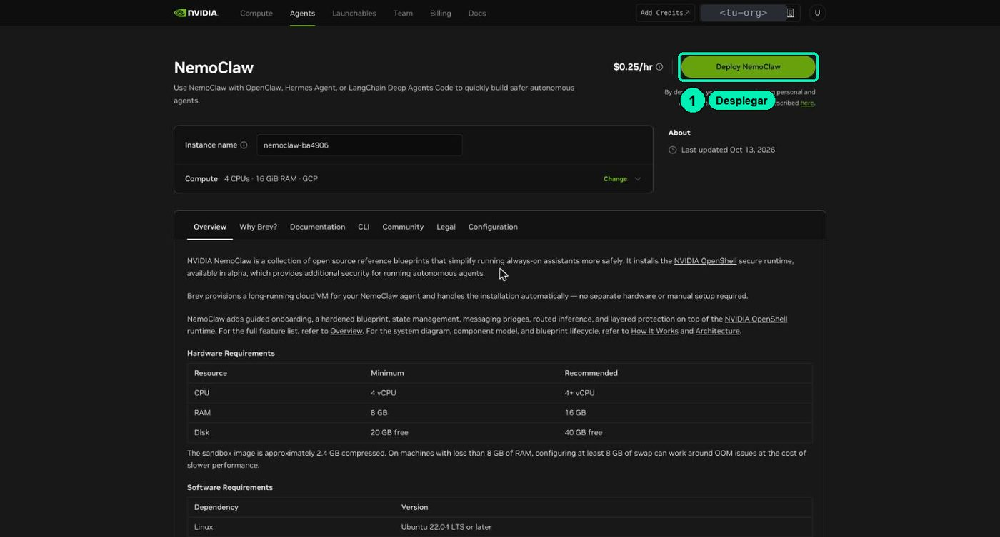
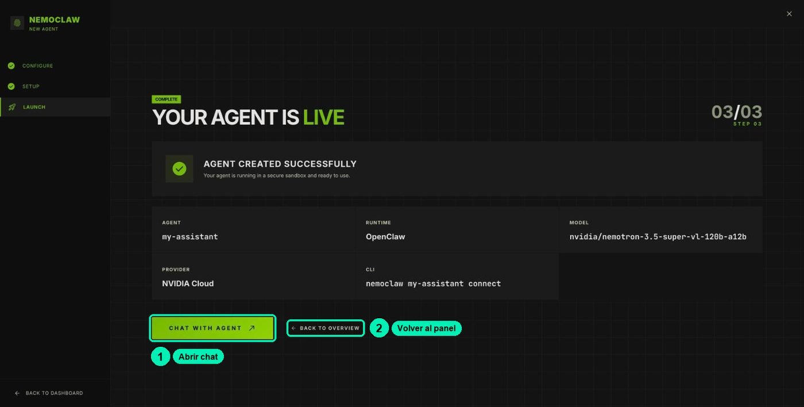

# Tu laboratorio en Brev

Los Módulos 4, 5 y 6 se hacen en un **laboratorio**: una computadora en la nube con NemoClaw ya instalado. Esta página te explica cuánto cuesta, cómo planear tu práctica para que te alcance el crédito de **1 USD**, cómo crear el laboratorio y cómo usar su tablero.

No necesitas instalar nada en tu computadora. Todo se hace desde el navegador.

> **Piénsalo como** rentar una oficina por horas: pagas mientras la luz está encendida, pagas por guardar tus cosas aunque la luz esté apagada, y si la entregas, pierdes lo que dejaste adentro.

## Lo que necesitas

- Una cuenta de NVIDIA (la misma de build.nvidia.com) para entrar a [Brev](https://brev.nvidia.com/).
- Tu cupón de **1 USD** de crédito.
- Tu API key `nvapi-` de la [clase 1.2](clases/1.2-cuenta-y-api-key-nvidia-build/README.md).
- Una computadora con navegador de escritorio (Chrome, Edge, Firefox o Safari). El celular no sirve para el laboratorio.

## 1 · Tu crédito de 1 USD

### Qué cuesta y qué no

| Estado de tu instancia | Qué cobra | Costo aprox. | ¿Se conserva tu trabajo? |
|---|---|---|---|
| **Running** (encendida) | La computadora y el disco | **≈USD 0.25 por hora** (la página de la instancia muestra ≈$0.26/hr) | Sí |
| **Stopped** (detenida) | Solo el disco | **≈USD 0.05 por hora, ≈USD 1.20 al día** | Sí |
| **Deleted** (borrada) | Nada | USD 0 | **No, se pierde** |

- Con 1 USD tienes unas **4 horas** de instancia encendida.
- Detenida **también cobra**: en un día gasta más que todo tu cupón. Detenerla sirve para pausas cortas, no para dejarla varios días.
- La instancia del curso es **solo CPU** (4 CPU, 16 GiB de memoria). El modelo de IA corre en la nube de NVIDIA, no en tu instancia.
- Lo que le preguntas al modelo se paga con los créditos de tu cuenta de **build.nvidia.com** (los de tu API key), no con el crédito de Brev. Las automatizaciones también gastan ahí: una sola ejecución de prueba usó ≈112 000 tokens. No dejes una automatización que se repita cada pocos minutos.

### El plan: una sola sentada

Primero mira los videos de los Módulos 4, 5 y 6. Después enciende la instancia y haz **las prácticas de laboratorio seguidas**, en una sola sentada. Al terminar, **bórrala**.

Las prácticas obligatorias son 4.1, 4.2, 4.3, 5.2 y 5.3. Las marcadas *(opcional)* puedes saltarlas: el resto del curso no depende de ellas.

| Clase | Práctica | Tiempo encendida (aprox.) |
|---|---|---|
| [4.1](clases/4.1-laboratorio-nemoclaw-en-brev/README.md) | Crear el laboratorio y conocer el tablero | ≈30 min |
| [4.2](clases/4.2-gateway-y-workspace-openclaw/README.md) | Gateway, workspace y memoria de la conversación | ≈20 min |
| [4.3](clases/4.3-agentes-siempre-activos/README.md) | Una skill y una automatización | ≈25 min |
| [4.4](clases/4.4-hermes-en-nemoclaw/README.md) (opcional) | Hermes en un segundo sandbox | ≈30 min |
| [5.2](clases/5.2-identidades-openshell/README.md) | Quién es quién: operador y sandbox | ≈20 min |
| [5.3](clases/5.3-sandbox-y-politicas/README.md) | Políticas de red y archivos | ≈25 min |
| [6.1](clases/6.1-clis-de-agentes/README.md) (opcional) | Comparar CLIs de agentes | ≈20 min |
| [6.2](clases/6.2-biblioteca-de-skills/README.md) (opcional) | Instalar la biblioteca de skills | ≈15 min |
| **Total obligatorio** (4.1, 4.2, 4.3, 5.2 y 5.3) | | **≈2 h 00 min ≈ USD 0.50** |
| **Total con todas las opcionales** | | **≈3 h 05 min ≈ USD 0.77** |

La 4.4 va entre la 4.3 y la 5.2: si te la saltas, pasa directo de la 4.3 a la 5.2. La 6.1 y la 6.2 van al final, después de la 5.3.

Con solo las obligatorias te sobran unos USD 0.50 por si algo tarda más de lo previsto. Si vas rápido, puedes terminar en ≈1 h 45 min (≈USD 0.44). Con todas las opcionales te sobran unos USD 0.23. Para otra combinación, suma los minutos: cada hora encendida cuesta ≈USD 0.25.

Cinco reglas para que te alcance:

1. **Mira primero los videos.** Así, cuando enciendas la instancia, ya sabes qué vas a hacer en cada clase.
2. **Haz todo en una sola sentada.** Ten a la mano tu API key y estas guías abiertas en otra pestaña.
3. **Usa Stop solo para pausas cortas.** Si tienes que parar, detén la instancia (**Stop**) y vuelve el mismo día o el siguiente. Nunca la dejes detenida varios días.
4. **Al terminar tu última práctica, guarda tu trabajo y borra la instancia: Delete.** Si no haces las opcionales, es la 5.3; si haces alguna, es la última opcional que hagas. Es la única forma de que deje de cobrar del todo (ver [5 · Al terminar](#5--al-terminar)).
5. **No actives la recarga automática** (*auto-recharge*) en **Billing**.

### Cómo canjear el cupón y revisar tu saldo

1. Entra a <https://brev.nvidia.com> con tu cuenta de NVIDIA. El menú de arriba tiene **Compute**, **Agents**, **Launchables**, **Team**, **Billing** y **Docs**.
2. Arriba a la derecha, revisa el **selector de organización**. En Brev el crédito es de la *organización*, no de tu usuario: si tienes varias (la de tu empresa y la personal), elige la tuya antes de canjear y antes de desplegar.
3. Haz clic en **Billing** → **Credits** → **Redeem Code** y pega tu cupón. No uses **Purchase Credits**: ese botón es para comprar.
4. Revisa el saldo en la **pastilla de saldo** de la barra de arriba. Debe decir 1.00 USD en tu organización.


**Si se te acaba el crédito:** Brev detiene o borra tus instancias. No pierdes la cuenta. Revisa [¿Qué pasa si se me acaban los créditos?](FAQ.md#brev) y pide ayuda en el foro del curso.

## 2 · Crea tu laboratorio

Este es el resumen. El paso a paso completo, con lo que verás en cada pantalla, está en la [clase 4.1](clases/4.1-laboratorio-nemoclaw-en-brev/README.md).

1. Abre el [enlace del launchable de NemoClaw](https://brev.nvidia.com/launchable/deploy/now?launchableID=env-3Azt0aYgVNFEuz7opyx3gscmowS&ncid=ref-dli-759990). Verás la máquina (4 CPUs · 16 GiB · GCP) y el botón **Deploy NemoClaw**. Haz clic en **Deploy NemoClaw**.

   

2. Ve a **Compute**. Tu instancia (se llama algo como `nemoclaw-xxxxxx`) pasa a **Running** en más o menos un minuto. Arriba tiene los botones **Stop**, **Delete** y un botón verde **NemoClaw**.

   

3. Haz clic en el botón verde **NemoClaw**. Se abre una pestaña nueva con una dirección como `https://nemoclaw-<tu-id>.gobrev.dev`. Te pide iniciar sesión con NVIDIA: usa la misma cuenta.
4. La primera vez verás **Choose how to configure your launchable**. Elige **SET UP IN THIS BROWSER** («No terminal required») y haz clic en **OPEN BROWSER SETUP →**.

   

5. En **Connect to AI**, deja **OpenClaw** como agente. El proveedor viene en OpenRouter: cámbialo a **NVIDIA CLOUD** y pega tu key `nvapi-` en el campo **NVIDIA CLOUD API KEY**. Haz clic en **CREATE AGENT**.

   

6. Espera unos 3 minutos en **Building your agent**. No recargues la pestaña. Al final verás **YOUR AGENT IS LIVE**, con tu agente `my-assistant`.

   

7. Haz clic en **Back to overview** para llegar a tu tablero.

## 3 · Tu tablero

El tablero es la página principal de tu laboratorio (`https://nemoclaw-<tu-id>.gobrev.dev/dashboard`). Arriba ves el uso de procesador, memoria y disco, y el estado de seguridad (por ejemplo, «20 allowed sites» y «13 network policies»). Abajo hay un panel de registros con filtros **All**, **VM**, **Gateway** y **Agent**.

En la tarjeta **MY-ASSISTANT** tienes cuatro botones:

| Botón | Qué abre | Para qué lo usas en el curso |
|---|---|---|
| **CHAT WITH AGENT** | El chat de OpenClaw, en una pestaña nueva. A la izquierda tiene **Home**, **Dashboards**, **Automations**, **Plugins** y **Sessions**. | Conversar con tu agente y crear automatizaciones (clase 4.3). |
| **SANDBOX TERMINAL** | Una terminal **dentro del cuarto** del agente (usuario `sandbox`, carpeta `/sandbox`). | Ver el mundo como lo ve el agente. |
| **VM TERMINAL** | La **terminal de operador**: la computadora que rodea al cuarto (usuario `ubuntu`). | Pegar los comandos de las guías. Desde aquí revisas y controlas al agente. |
| **OPENSHELL TUI** | El panel del guardia de OpenShell, en modo texto. | Ver la política del sandbox y aprobar o rechazar accesos bloqueados (Módulo 5). |


### Consejos para la terminal de operador (VM TERMINAL)

- Se abre como una ventana encima del tablero. **Haz clic dentro del área negra antes de escribir.** Si escribes sin hacer clic, las teclas van al tablero y pueden abrir pestañas o no pasar nada.
- **Shift + Esc** cierra la terminal y lo que esté corriendo en ella. La tecla Esc sola se envía a la terminal.
- Para pegar un comando de la guía: cópialo aquí y pégalo en la terminal con **Ctrl + V** (en Mac, **Cmd + V**). Luego presiona **Enter**.
- Todos los comandos `nemoclaw` imprimen una línea `ExperimentalWarning: SQLite is an experimental feature`. Ignórala: no es un error.

### Trae los archivos del curso

Varias clases usan archivos del curso (la FAQ de ejemplo, la skill de soporte). Este comando los descarga en la carpeta `~/curso` de tu laboratorio. Pégalo una vez en la **VM TERMINAL**, al empezar:

```bash
git clone --depth 1 https://github.com/uncrayon/curso-seguridad-agentes-nemoclaw ~/curso
```

Después, las guías usan rutas como `~/curso/datos/faq/` o `~/curso/clases/4.3-agentes-siempre-activos/skills/soporte-nemoclaw/`.

## 4 · Si cierras la pestaña o vuelves otro día

Cerrar la pestaña no apaga nada ni borra tu trabajo. Para volver a tu tablero:

1. Entra a <https://brev.nvidia.com> → **Compute** → tu instancia.
2. Si está detenida (**Stopped**), enciéndela y espera a que diga **Running**.
3. Haz clic en el botón verde **NemoClaw**.
4. Puede que te pida iniciar sesión con NVIDIA otra vez. Es normal: hazlo con la misma cuenta y llegarás a tu tablero.

Si el agente no responde justo después de encender la instancia, espera un par de minutos y revisa el panel de registros del tablero. Si sigue sin responder, ve a la [FAQ: conexión con tu laboratorio](FAQ.md#conexion-laboratorio).

## 5 · Al terminar

Cuando termines tu última práctica (la 5.3 si no haces las opcionales; si haces alguna, la última que hagas):

1. **Guarda lo que quieras conservar.** Este comando, en la **VM TERMINAL**, muestra en pantalla tu `SOUL.md` y los reportes que escribió tu agente:

   ```bash
   nemoclaw my-assistant exec -- bash -lc 'cd /sandbox/.openclaw/workspace && for f in SOUL.md reportes/*.md; do echo "===== $f"; cat "$f"; done'
   ```

   Selecciona el texto con el mouse, cópialo y pégalo en un documento tuyo. Si prefieres no usar la terminal, pídele al agente en el chat: «Muéstrame el contenido de SOUL.md», y copia la respuesta.
2. En la consola de Brev: **Compute** → tu instancia → **Delete**. Confirma.
3. Revisa en **Billing** que no quede ninguna instancia cobrando y anota tu saldo.

## Si algo sale mal

- [Preguntas frecuentes: Brev y el launchable](FAQ.md#brev)
- [Preguntas frecuentes: conexión con tu laboratorio (tablero, chat y terminal)](FAQ.md#conexion-laboratorio)
- [Glosario en palabras simples](GLOSARIO.md)
