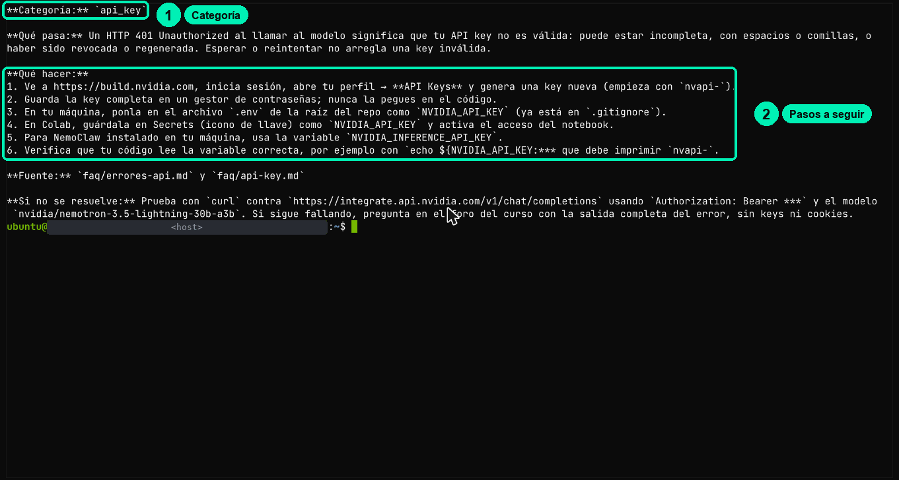
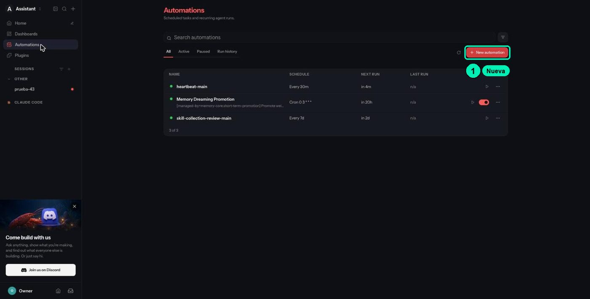
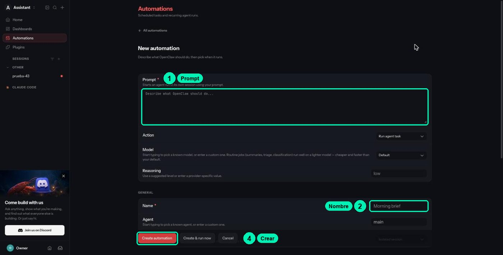
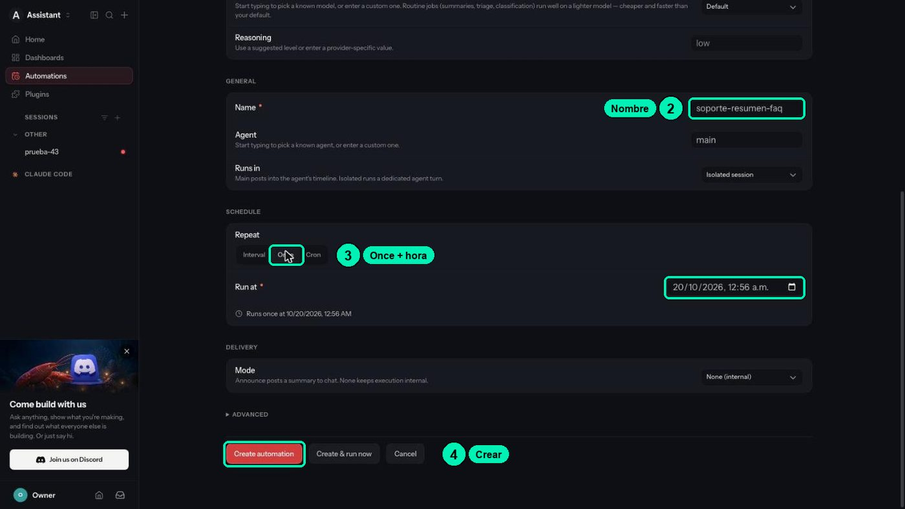
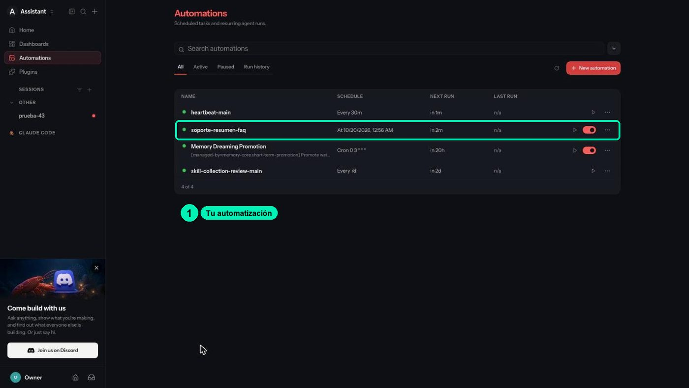
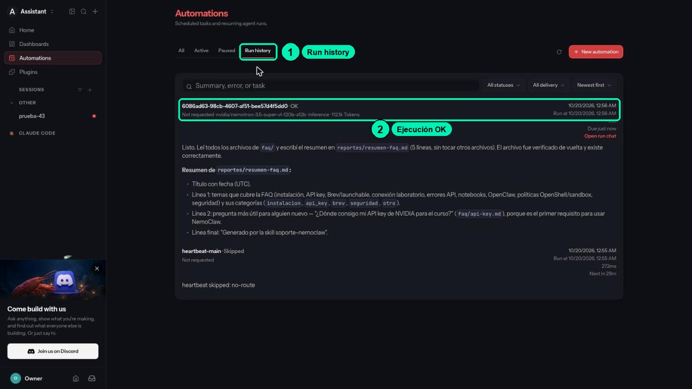
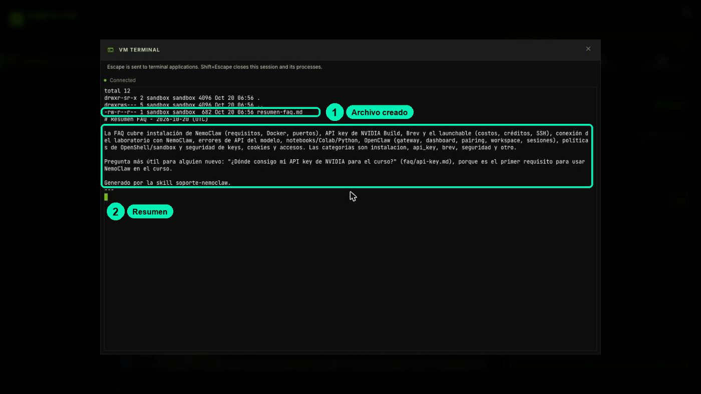

# 4.3 · Agentes en operación continua y programada

Instala la skill `soporte-nemoclaw` con la FAQ del curso, programa una tarea que escribe un resumen sin que nadie escriba en el chat y aprende a describir cualquier automatización con 3 controles.

| | |
|---|---|
| Duración del video | ≈8 min |
| Práctica | Laboratorio en Brev: tablero de NemoClaw + terminal del navegador ([cookbook.md](cookbook.md)) |
| Habilidad | Operar agentes en modo continuo |

Material: [diapositivas](slides.html) · [recetario de terminal](cookbook.md) · [skill soporte-nemoclaw](skills/soporte-nemoclaw/SKILL.md) · [preguntas frecuentes del curso](../../FAQ.md)

> Basado en la lección 03c del curso NVIDIA DLI «NemoClaw» (Apache-2.0).

## Lo esencial (sin tecnicismos)

**La idea:** Tu agente aprende una tarea nueva leyendo una receta escrita en texto, y empieza a trabajar solo a una hora fija, aunque nadie le escriba. Eso es útil y también es un riesgo: lo que corre solo, corre aunque nadie lo mire.

**Piénsalo como:** una tarjeta de receta (la skill) y la alarma del despertador (la tarea programada).

**Palabras nuevas:** [skill](../../GLOSARIO.md), [cron o tarea programada](../../GLOSARIO.md).

**Hazlo sin programar (≈10 min):** Escribe la descripción de una skill para tu propio trabajo, en 2 o 3 frases: qué resuelve, para quién y con qué palabras pediría ayuda alguien (los errores, productos o situaciones que mencionaría). Compárala con la descripción de [soporte-nemoclaw](skills/soporte-nemoclaw/SKILL.md). Si tu laboratorio está encendido, abre el chat con **CHAT WITH AGENT** y haz clic en **Automations** en la barra lateral: verás las tareas que el agente ya trae (por ejemplo, `heartbeat-main`, cada 30 minutos). Para cada una, anota qué la hace empezar, mirando la columna **SCHEDULE**.

**Qué te llevas:** sabes escribir la descripción que hace que un agente encuentre su receta, y describir cualquier automatización con tres preguntas: qué recuerda, qué instrucciones sigue y qué la hace empezar.

**Tu crédito:** esta práctica usa ≈25 min de tu sesión única de laboratorio (ver [LABORATORIO.md](../../LABORATORIO.md)). La tarea programada también gasta créditos del modelo en build.nvidia.com, no de Brev: una sola ejecución usó ≈112 mil tokens. Si paras por hoy, haz **Stop** y vuelve pronto; al final de todo el laboratorio (después de la 5.3, o de la última práctica complementaria que hagas), **Delete**.

## Lo que vas a lograr

- Instalar una skill (una carpeta con `SKILL.md`) en tu agente y comprobar que la usa, primero de forma explícita y luego de forma automática.
- Programar en **Automations** una tarea que escribe un archivo sin ningún mensaje de chat, y verificarla como operador.
- Describir cualquier mecanismo "siempre activo" con 3 controles: sesión, directiva y disparador.

## Antes de empezar

- Las clases 4.1 y 4.2 terminadas: instancia **Running** en la consola de Brev, el tablero de NemoClaw abierto con el botón verde **NemoClaw** y tu `SOUL.md` personalizado.
- Los archivos del curso en la máquina, en `~/curso`. Los clonaste en la clase 4.1. Si no están, abre **VM TERMINAL** en el tablero, haz clic dentro del área negra y pega:
  ```bash
  git clone --depth 1 https://github.com/uncrayon/curso-seguridad-agentes-nemoclaw ~/curso
  ```
  Ahí vienen la skill (`~/curso/clases/4.3-agentes-siempre-activos/skills/soporte-nemoclaw/`) y la FAQ del curso (`~/curso/datos/faq/`).
- Cada comando `nemoclaw` imprime una línea `ExperimentalWarning: SQLite is an experimental feature`. Es inofensiva: ignórala.

## Los 3 controles

Toda ejecución del agente, la pidas tú o no, se describe con tres preguntas:

- **Sesión:** ¿qué contexto hereda la ejecución?
- **Directiva:** ¿de dónde salen sus instrucciones?
- **Disparador:** ¿qué hace que empiece?

| Mecanismo | Sesión | La directiva vive en | Disparador | En esta clase |
|---|---|---|---|---|
| Skill | Reutiliza la del que la invoca | `workspace/skills/<nombre>/SKILL.md` | Una petición en la conversación | La instalas y la usas |
| Heartbeat | Una sesión dedicada al heartbeat | `HEARTBEAT.md` | Temporizador del gateway, cada 30 min por defecto | Solo concepto |
| Cron (Automations) | Aislada: una sesión nueva en cada disparo | El **Prompt** de la automatización | Hora programada (**Once**, **Interval** o **Cron**) | La programas y la verificas |
| Subagente | Nueva; el agente padre conserva la referencia | Las instrucciones que le da el padre | El agente padre decide a mitad de un turno | Solo concepto |

## Paso a paso

### Parte A · Mira cómo es una skill (página del curso)

1. **Abre la skill** [soporte-nemoclaw](skills/soporte-nemoclaw/SKILL.md) en esta misma página del curso. Fíjate en sus tres partes:
   - **La etiqueta** (entre las dos líneas `---`): `name` es el nombre de la skill y `description` dice qué resuelve y con qué palabras pregunta un estudiante. El agente usa esa descripción para decidir si la receta le sirve.
   - **Los pasos:** clasifica la duda, busca en la FAQ, responde con un formato fijo y cita la fuente.
   - **Las reglas:** nunca pedir keys, nunca inventar comandos, y solo escribir en `reportes/`.

   Una skill es solo eso: una carpeta con un archivo `SKILL.md` escrito en texto normal.

### Parte B · Instala la skill y la FAQ (VM TERMINAL)

2. **Abre la terminal de operador.** En el tablero de NemoClaw, en la tarjeta **MY-ASSISTANT**, haz clic en **VM TERMINAL**. Haz clic dentro del área negra antes de escribir; si no, tus teclas activan atajos del tablero.

3. **Instala la skill en el agente.** Este comando le pide a NemoClaw que revise la carpeta de la skill y la copie al escritorio del agente:
   ```bash
   nemoclaw my-assistant skill install ~/curso/clases/4.3-agentes-siempre-activos/skills/soporte-nemoclaw/
   ```
   Deberías ver:
   ```text
   ✓ Validated SKILL.md
   Installed soporte-nemoclaw from path -> /sandbox/.openclaw/workspace/skills/soporte-nemoclaw
   ```
   NemoClaw valida que la carpeta tenga un `SKILL.md` con etiqueta y `name` antes de instalarla.

4. **Sube la FAQ al escritorio del agente.** Este comando copia la carpeta `faq/` del curso dentro del workspace:
   ```bash
   nemoclaw my-assistant upload ~/curso/datos/faq/ /sandbox/.openclaw/workspace/
   ```
   El destino termina en `workspace/`, no en `faq/`. Si escribes `/sandbox/.openclaw/workspace/faq/` como destino, la carpeta queda anidada en `faq/faq/` y la skill no la encuentra.

5. **Comprueba las dos cosas.** Este comando lista, desde dentro del sandbox, la skill instalada y los archivos de la FAQ:
   ```bash
   nemoclaw my-assistant exec -- ls /sandbox/.openclaw/workspace/skills/ /sandbox/.openclaw/workspace/faq/
   ```
   Deberías ver `soporte-nemoclaw` en `skills/` y los `.md` de la FAQ (`api-key.md`, `brev.md`, `errores-api.md`…) directamente en `faq/`.

### Parte C · Comprueba que el agente la usa

6. **Uso explícito (en el chat).** En el tablero, haz clic en **CHAT WITH AGENT**. Se abre el chat de OpenClaw en otra pestaña. Escribe:
   > Lee /sandbox/.openclaw/workspace/skills/soporte-nemoclaw/SKILL.md y síguelo para esta duda de un estudiante: "Si detengo mi instancia de Brev, ¿me siguen cobrando?"

   Deberías ver una respuesta con **Categoría:**, pasos numerados y **Fuente:** `faq/<archivo>.md`. Esto prueba que el agente sigue la receta cuando le das la ruta.

7. **Uso automático (sin dar la ruta).** Ahora pregunta en una conversación **nueva**, sin mencionar la skill. Tienes dos caminos:
   - **En el chat:** abre una sesión nueva desde la barra lateral (el botón **+** junto a **SESSIONS**) y escribe: *"Mi API key de NVIDIA me da 401, ¿qué hago?"*
   - **En la VM TERMINAL:** este comando le hace la misma pregunta al agente en una sesión llamada `prueba-43`:
     ```bash
     nemoclaw my-assistant agent --session-key prueba-43 -m 'Mi API key de NVIDIA me da 401, ¿qué hago?'
     ```

   Si el agente usa la skill solo, la respuesta trae el formato de la skill. En la prueba del curso respondió con **Categoría:** `api_key`, pasos numerados y **Fuente:** `faq/errores-api.md` y `faq/api-key.md`. La sesión `prueba-43` también aparece después en la barra lateral del chat.

   

   Si no usa la skill, la descripción no fue suficiente: eso es el reto de esta clase.

### Parte D · Programa una tarea en Automations

Ahora el agente va a trabajar sin que nadie le escriba. Vas a programar una tarea que se ejecuta **una sola vez**, 2 minutos después, y se borra sola.

8. **Abre Automations.** En el chat de OpenClaw, haz clic en **Automations** en la barra lateral. Verás la lista *Scheduled tasks and recurring agent runs* con las tareas que el agente ya trae: `heartbeat-main` (**Every 30m**), **Memory Dreaming Promotion** (**Cron 0 3 \* \* \***) y `skill-collection-review-main` (**Every 7d**). Haz clic en **New automation**, arriba a la derecha.

   

9. **Escribe la instrucción.** En **Prompt**, pega:
   > Usa la skill soporte-nemoclaw. Lee los archivos de faq/ y escribe en reportes/resumen-faq.md un resumen de 5 líneas: qué temas cubre la FAQ y cuál es la pregunta más útil para alguien nuevo. No cambies ningún otro archivo.

   Deja **Action** en **Run agent task**, **Model** en **Default** y **Reasoning** en **low**.

   

10. **Ponle nombre y horario.**
    - En **GENERAL → Name**, escribe `soporte-resumen-faq`. Deja **Agent** en `main` y **Runs in** en **Isolated session**.
    - En **SCHEDULE → Repeat**, elige **Once**.
    - En **Run at**, pon la fecha de hoy y una hora **2 minutos después** de la hora de tu reloj. Este campo usa la hora local de tu navegador.
    - En **DELIVERY → Mode**, deja **None (internal)**: el resultado no se publica en el chat.
    - Abre **ADVANCED** y revisa que **Delete after run** esté encendido. Con **Once** viene encendido.

    

11. **Crea la tarea.** Haz clic en **Create automation** (no en **Create & run now**). Deberías ver `soporte-resumen-faq` en la lista, con **NEXT RUN** en `in 2m`.

    

12. **Espera sin escribir en el chat.** Quita las manos del teclado. A la hora fijada, la tarea muestra **Running** con un indicador que gira. Luego abre la pestaña **Run history**. Deberías ver una ejecución con estado **OK**, el modelo, la cantidad de tokens (en la prueba del curso, ≈112 mil) y el resumen que escribió el agente, con un enlace **Open run chat**. Como tenía **Delete after run**, la tarea ya no aparece en la lista **All**.

    

### Parte E · Compruébalo como operador (VM TERMINAL)

Un **OK** en el historial dice que la ejecución terminó, no que el archivo exista. Esa prueba la haces tú.

13. **Lee el archivo.** En la VM TERMINAL, este comando lista la carpeta `reportes/` y muestra el resumen:
    ```bash
    nemoclaw my-assistant exec -- bash -lc 'ls -la /sandbox/.openclaw/workspace/reportes/; cat /sandbox/.openclaw/workspace/reportes/resumen-faq.md'
    ```
    Deberías ver `resumen-faq.md` con dueño `sandbox` (el usuario del cuarto) y un texto que empieza con `# Resumen FAQ -` y la fecha, y termina con `Generado por la skill soporte-nemoclaw.` Nadie escribió en el chat y el archivo existe: esa es la prueba.

    

    La hora del archivo está en UTC, la hora universal. Por eso puede no coincidir con la de tu reloj.

14. **Revisa la lista de tareas como operador.** Este comando muestra las tareas programadas del agente, vistas desde dentro del sandbox:
    ```bash
    nemoclaw my-assistant exec -- openclaw cron list
    ```
    Deberías ver una tabla con `heartbeat:main` (every 30m), la tarea de memoria (`cron 0 3 * * *`) y `skill-collection-review` (every 7d). Tu `soporte-resumen-faq` ya no está: se borró sola.

**Cuida el crédito del modelo.** Esa ejecución usó ≈112 mil tokens. Nunca dejes una tarea con **Interval** de pocos minutos corriendo: gastaría eso en cada disparo. Para pausar o borrar una tarea, usa el menú **⋯** de su fila en **Automations**.

### Parte F · Heartbeat y subagentes (solo concepto)

- **Heartbeat:** cada cierto tiempo (30 min por defecto en OpenClaw) el agente despierta en una sesión dedicada, revisa pendientes y lee `HEARTBEAT.md` si existe. En **Automations** es la tarea `heartbeat-main` (**Every 30m**). En el laboratorio, su historial dice **Skipped** con `heartbeat skipped: no-route`: es normal, no lo arregles. En una instalación propia se ajusta con `NEMOCLAW_AGENT_HEARTBEAT_EVERY` antes del onboarding (detalle en el [cookbook](cookbook.md), receta 8).
- **Subagentes:** el agente padre lanza un hijo con una sesión nueva y le pasa instrucciones de tarea, como los subagentes de la clase 3.3. La diferencia: aquí el hijo corre dentro del mismo sandbox, con la misma política.

**Atención:** una tarea programada corre aunque nadie la esté mirando. Una instrucción como "envía el reporte diario" se dispara igual. Cada disparo usa una sesión aislada, pero los archivos compartidos del workspace sí pueden influir en ejecuciones futuras. Nombra tus tareas, revisa **Automations** y borra las que no reconozcas.

## Comprueba que funcionó

- [ ] `skill install` respondió `✓ Validated SKILL.md` e `Installed soporte-nemoclaw`.
- [ ] `faq/` está en el workspace con los archivos de la FAQ (no en `faq/faq/`).
- [ ] Una pregunta con la ruta de la skill devuelve **Categoría**, pasos y **Fuente: faq/…**.
- [ ] Una pregunta **sin** la ruta, en una sesión nueva, también sigue el formato de la skill.
- [ ] Tu automatización `soporte-resumen-faq` terminó en **OK** en **Run history**.
- [ ] Leíste `reportes/resumen-faq.md` como operador, con dueño `sandbox`.
- [ ] `openclaw cron list` ya no muestra tu tarea.
- [ ] Puedes explicar skill, heartbeat, cron y subagente con sesión, directiva y disparador.

## Errores comunes

| Síntoma | Causa | Solución |
|---|---|---|
| **NEXT RUN** dice `in 2h`, `in 6h` o una fecha rara, en vez de `in 2m` | **Run at** usa la hora local de tu navegador y pusiste otra hora o otro día. | Borra la tarea con el menú **⋯** y créala otra vez con la hora de tu reloj más 2 minutos. |
| **Run history** dice **OK**, pero no hay archivo | El agente dijo que terminó y no escribió, o escribió en otra ruta. | El OK no prueba nada por sí solo: léelo como operador (paso 13). Para buscarlo: `nemoclaw my-assistant exec -- bash -lc 'grep -rl "Generado por la skill soporte-nemoclaw" /sandbox/.openclaw/workspace/'`. |
| La tarea se queda en **Running** mucho tiempo | El modelo tarda en responder o la ejecución llegó a su límite de tiempo. | Espera unos minutos y revisa **Run history**. Si aparece un error, comprueba que **Inference** diga `healthy` con `nemoclaw my-assistant status` y crea la tarea otra vez. |
| `heartbeat-main` dice **Skipped** · `no-route` | Así se comporta el heartbeat en este laboratorio. | Es normal. No es tu tarea ni un error tuyo. |
| El agente no usa la skill si no le das la ruta | La `description` de la etiqueta es vaga ("skill de soporte") y no coincide con la pregunta. | Reescribe la `description`: qué hace, para quién y con qué palabras preguntaría el estudiante. Reinstala con `skill install` y prueba en una sesión **nueva**. |
| `skill install` falla por el `SKILL.md` | Falta la etiqueta, falta `name`, o el nombre tiene caracteres no permitidos. | Etiqueta entre `---` con `name` (solo letras, números, puntos, guiones y guiones bajos) y `description`. |
| La skill responde "No encuentro la FAQ del curso en el workspace" | No subiste la FAQ, o quedó en `faq/faq/` porque el destino terminaba en `faq/`. | Revisa con `nemoclaw my-assistant exec -- ls -R /sandbox/.openclaw/workspace/faq/` y sube de nuevo con destino `/sandbox/.openclaw/workspace/`. |
| Escribes en la VM TERMINAL y pasan cosas raras en el tablero | La terminal no tenía el foco y tus teclas activaron atajos del tablero. | Haz clic dentro del área negra antes de escribir. **Shift+Escape** cierra la terminal y sus procesos. |

## Reto

**Que el agente descubra la skill solo.** Reemplaza temporalmente la `description` de tu `SKILL.md` por `Skill de soporte.`, reinstálala y haz la pregunta del paso 7 en una sesión nueva. Luego restaura la descripción buena (la original o una mejor) y repite. Los comandos están en el [cookbook](cookbook.md), receta 5.

Criterio de éxito: con la descripción vaga el agente no sigue el formato de la skill; con la buena, en una sesión nueva y **sin darle la ruta**, responde con **Categoría**, pasos y **Fuente:** `faq/…`. Anota las dos respuestas.

## Avance del proyecto

**Soporte NemoClaw ya está desplegado en OpenClaw:**

- La skill `soporte-nemoclaw` instalada, con la FAQ del curso en `faq/` dentro del workspace.
- Una tarea programada en **Automations** que dejó `reportes/resumen-faq.md` sin intervención.

Repite la pregunta de la línea base de 4.1 ("Mi notebook responde HTTP 401") y compara. Guarda la respuesta nueva en tus notas del proyecto (`proyecto/linea-base-4.1.md`), debajo de la anterior, y anota la diferencia: ¿ahora cita la FAQ? ¿Sigue las categorías del router de la clase 3.1? En «Seguridad agéntica con OpenShell» vas a revisar qué riesgos abrió todo esto: un agente con datos, herramientas y tareas que corren solas.

## Recursos

- [NemoClaw · Referencia de comandos: `skill install`, `skill list`, `skill remove`, `upload`](https://docs.nvidia.com/nemoclaw/latest/user-guide/openclaw/reference/commands.md)
- [NemoClaw · Configurar heartbeats del agente](https://docs.nvidia.com/nemoclaw/latest/user-guide/openclaw/configure-agents/configure-agent-heartbeats.md)
- [OpenClaw · Automatización: cron vs. heartbeat](https://docs.openclaw.ai/cron-vs-heartbeat)
- [Anthropic · Agent Skills](https://www.anthropic.com/news/skills) y [Voyager (arXiv 2305.16291)](https://arxiv.org/abs/2305.16291)
- `man 8 cron` para el cron clásico de Unix (la idea es la misma: una hora y un comando)
