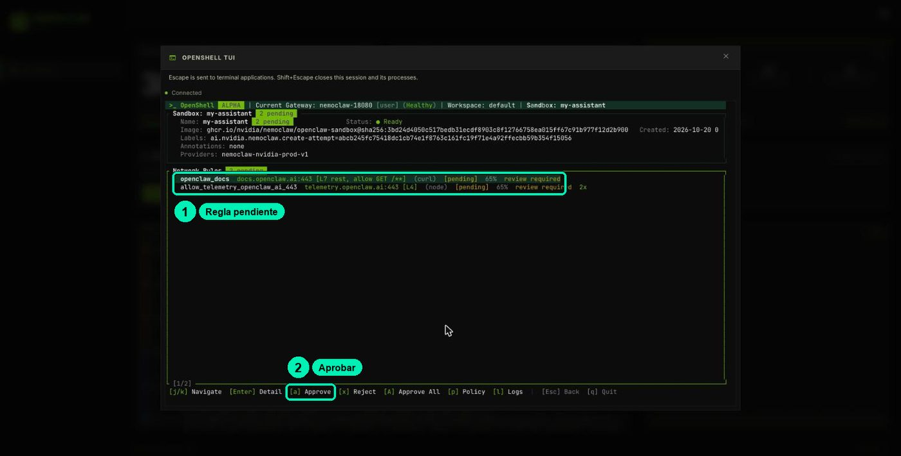
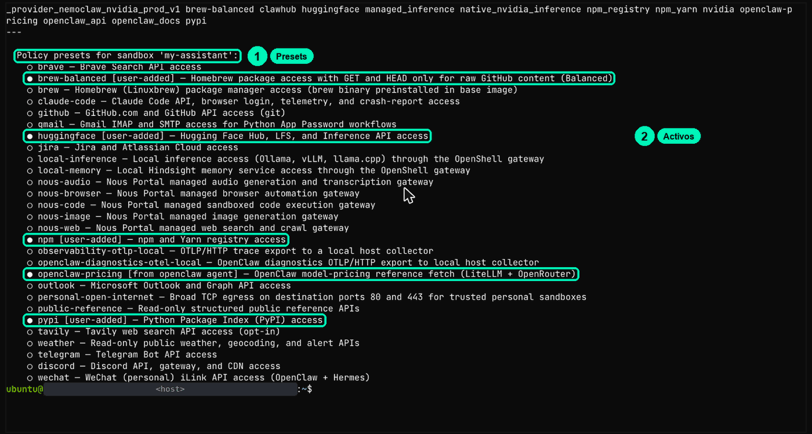

# 5.3 · Restringe herramientas, archivos y red

Lee la política real de tu sandbox, predice qué permite y qué bloquea, compruébalo en vivo y cámbiala con los comandos de NemoClaw.

| | |
|---|---|
| Duración del video | ≈9 min |
| Práctica | Laboratorio en Brev: tablero de NemoClaw + terminal del navegador ([cookbook.md](cookbook.md)) + [notebook](5.3-sandbox-y-politicas.ipynb) |
| Habilidad | Definir y verificar un sandbox en OpenShell |

Material: [diapositivas](slides.html) · [cookbook del lab](cookbook.md) · [notebook](5.3-sandbox-y-politicas.ipynb) · [FAQ del curso](../../FAQ.md)

> Basado en la lección 04a-safety del curso NVIDIA DLI «NemoClaw» (Apache-2.0) y en `nemoclaw-blueprint/policies/` de NVIDIA/NemoClaw (Apache-2.0).

## Lo esencial (sin tecnicismos)

**La idea:** El sandbox obedece una lista de reglas escritas: qué carpetas puede leer, dónde puede escribir y a qué sitios puede salir cada programa. Puedes leer esa lista, adivinar qué va a pasar y comprobarlo. Y aun con buenas reglas, un secreto que el agente lee con permiso puede escaparse: el sandbox es una capa, no la solución completa.

**Piénsalo como:** el reglamento del guardia en la puerta.

**Palabras nuevas:** [política](../../GLOSARIO.md), preset (un paquete de reglas ya escrito que se agrega a la política, como una hoja extra que engrapas al reglamento).

**Hazlo sin programar (≈10 min):** Antes de ver resultados, escribe "permitido" o "bloqueado" junto a cada petición: 1) el programa `curl` consulta la API de modelos de NVIDIA (`integrate.api.nvidia.com`); 2) el agente abre `docs.openclaw.ai` con sus herramientas; 3) `curl` abre `example.com`; 4) el agente crea un archivo en la carpeta temporal `/tmp`; 5) el agente crea un archivo en la carpeta del sistema `/etc`; 6) el agente cambia su propia personalidad (`SOUL.md`); 7) el agente lee un archivo con un secreto y te dice qué contiene. Después compara: abre el [notebook](5.3-sandbox-y-politicas.ipynb) en Colab y presiona ▶, o en el tablero de tu laboratorio haz clic en **OPENSHELL TUI**, elige `my-assistant`, presiona **Enter** y mira las carpetas y las reglas de red. (Respuestas en el laboratorio: permitidos 1, 4, 6 y 7; bloqueados 2, 3 y 5. El 1, el 6 y el 7 son la sorpresa: por eso el sandbox es solo una capa.)

**Qué te llevas:** Puedes leer las reglas de un agente y decir, antes de probarlo, qué puede y qué no puede hacer, y qué riesgo queda aunque las reglas estén bien.

**Tu crédito:** esta práctica usa ≈25 min de tu sesión única de laboratorio (≈USD 0.10). Es la última práctica obligatoria del laboratorio. Si paras por hoy, haz **Stop** en la consola de Brev y vuelve pronto. Al terminar: si vas a hacer las prácticas opcionales del Módulo 6, deja la instancia encendida y sigue; si no, guarda lo que quieras y **Delete** (ver [LABORATORIO.md](../../LABORATORIO.md)).

## Lo que vas a lograr

- Leer la política real de OpenShell (`filesystem_policy`, `landlock`, `process`, `network_policies`) y explicar cada sección.
- Predecir y comprobar bloqueos de red y de archivos, y leer un bloqueo en el registro o en la OPENSHELL TUI.
- Aprobar o rechazar una petición bloqueada y explicar por qué eso dura menos que un preset.
- Agregar y quitar el preset de *Soporte NemoClaw* y explicar por qué el sandbox es solo una capa.

## Antes de empezar

- Laboratorio de Brev encendido, con el tablero abierto (`https://nemoclaw-<tu-id>.gobrev.dev/dashboard`) y `nemoclaw my-assistant status` en verde.
- Hiciste la clase 5.2: sabes abrir la **VM TERMINAL** y la **OPENSHELL TUI**, y usar `openshell sandbox exec -n my-assistant -- …`.
- Tienes tu hoja `trifecta.md` (5.1) con la sección "Identidad" (5.2).
- Para el notebook: Python 3.10+ o Colab. No necesita API key ni PyPI extra: si tienes PyYAML lo usa, si no, usa un dict equivalente.

## Paso a paso

### Parte 1 · Lee la política real

**En el panel del guardia.** En el tablero, haz clic en **OPENSHELL TUI**, elige `my-assistant` con **j**/**k** y presiona **Enter**. Ves las carpetas de solo lectura, las de lectura y escritura, y las reglas de red. El tablero también lo resume arriba: «13 network policies».

**Como operador.** En la **VM TERMINAL**, este comando imprime la política completa del sandbox. Guárdala antes de cambiar nada:

```bash
openshell policy get my-assistant --full > ~/politica-antes.txt
less ~/politica-antes.txt
```

(Sales de `less` con **q**.) Deberías ver un encabezado de estado, una línea `---` y el archivo de reglas. Este es un extracto de la política base publicada de OpenClaw en NemoClaw (`nemoclaw-blueprint/policies/openclaw-sandbox.yaml`):

```yaml
filesystem_policy:
  include_workdir: true
  read_only: [/usr, /lib, /proc, /dev/urandom, /app, /etc, /var/log, /var/lib/dpkg]
  read_write: [/tmp, /dev/null, /dev/pts, /sandbox/.openclaw, /sandbox/.nemoclaw, /home/linuxbrew]
landlock:
  compatibility: best_effort
process:
  run_as_user: sandbox
  run_as_group: sandbox
network_policies:
  openclaw_docs:
    name: openclaw_docs
    endpoints:
      - host: docs.openclaw.ai
        port: 443
        protocol: rest          # el proxy inspecciona cada petición HTTP
        enforcement: enforce
        rules:
          - allow: { method: GET, path: "/**" }
    binaries:
      - { path: /usr/local/bin/openclaw }
```

Léelo así:
- **Red**: todo está cerrado salvo los grupos de `network_policies`. Cada grupo une **destinos** (host, puerto, método, ruta) con **programas**.
- **Archivos**: Landlock deja leer `read_only`, leer y escribir `read_write` y `/sandbox`. Todo lo demás se niega.
- **Proceso**: corre como `sandbox`. seccomp no aparece en este archivo: lo aplica OpenShell siempre.

En el laboratorio de prueba, los 13 grupos de red eran: `_provider_nemoclaw_nvidia_prod_v1`, `brew-balanced`, `clawhub`, `huggingface`, `managed_inference`, `native_nvidia_inference`, `npm_registry`, `npm_yarn`, `nvidia`, `openclaw-pricing`, `openclaw_api`, `openclaw_docs` y `pypi`. Los que no están en el extracto vienen del tier, de los presets activos y del proveedor de inferencia.

### Parte 2 · Practica en el notebook: predecir → evaluar → puntuar

Abre [`5.3-sandbox-y-politicas.ipynb`](5.3-sandbox-y-politicas.ipynb) en Colab. Usa la política base publicada y un evaluador en Python. Escribe tus predicciones para 12 acciones y presiona ▶:

```text
✗ d curl → API de NVIDIA (binario equivocado)  predijiste ALLOW → DENY  | el binario '/usr/bin/curl' no está permitido en 'nvidia'
✗ i ESCRIBIR SOUL.md (la persona)              predijiste DENY  → ALLOW | … está bajo read_write /sandbox/.openclaw
Puntaje: 7/12
```

Las filas ✗ son la lección: el permiso va **atado al programa**, las reglas L7 frenan métodos y la política **no** protege `SOUL.md`. Guarda la fila **d**: en la Parte 3 vas a ver que tu laboratorio no dice lo mismo.

### Parte 3 · Compruébalo en el sandbox

El simulador predice; el sandbox decide. Escribe primero tu predicción para cada línea y después pégalas en la VM TERMINAL:

```bash
openshell sandbox exec -n my-assistant -- curl -sS -m 8 -o /dev/null -w 'code=%{http_code}\n' https://inference.local/v1/models
openshell sandbox exec -n my-assistant -- curl -sS -m 8 -o /dev/null -w 'code=%{http_code}\n' https://example.com
openshell sandbox exec -n my-assistant -- curl -sS -m 6 -o /dev/null -w 'code=%{http_code}\n' http://169.254.169.254/latest/meta-data/
openshell sandbox exec -n my-assistant -- curl -sS -m 8 -o /dev/null -w 'code=%{http_code}\n' https://integrate.api.nvidia.com/v1/models
openshell sandbox exec -n my-assistant -- curl -sS -m 8 -o /dev/null -w 'code=%{http_code}\n' https://pypi.org/simple/
```

Lo que salió en el laboratorio de prueba:

| Petición | Resultado | Qué significa |
|---|---|---|
| `inference.local` | `code=503` | La conexión **pasó** al guardia; quien responde 503 es la ruta interna, porque este laboratorio usa la ruta nativa de NVIDIA |
| `example.com` | `curl: (56) CONNECT tunnel failed, response 403` | **Bloqueado** por el guardia: no está en la lista |
| `169.254.169.254` (datos de la nube) | `code=403` | **Bloqueado**. Como es HTTP sin cifrar, el 403 del guardia aparece como código |
| `integrate.api.nvidia.com` | `code=200` | **Permitido para curl**. El perfil nativo de inferencia de NVIDIA lo abre (fíjate en los grupos `native_nvidia_inference` y `_provider_nemoclaw_nvidia_prod_v1`) |
| `pypi.org` | `code=200` | Permitido por el tier **Balanced** (grupo `pypi`) |

La fila de `integrate.api.nvidia.com` es un hallazgo real, no un error: el notebook dice DENY porque usa la política base; tu laboratorio tiene además el perfil del proveedor. Anótalo en tu `trifecta.md`: es un destino al que cualquier programa del sandbox puede llegar.

Ahora los archivos:

```bash
openshell sandbox exec -n my-assistant -- sh -c 'ls /var/lib/dpkg | head -3'
openshell sandbox exec -n my-assistant -- ls /var/lib/apt/lists
openshell sandbox exec -n my-assistant -- touch /usr/prueba
```

Esperado: la primera lista archivos (`/var/lib/dpkg` está en `read_only`); la segunda y la tercera dan `Permission denied`. La segunda es la interesante: cualquier usuario de Linux podría leer `/var/lib/apt/lists`. Quien la niega es Landlock, porque no está en la política.

Si una predicción no coincide, revisa tres cosas antes de concluir: la política **activa** (no la del notebook), el **programa** real y **quién** respondió (¿el guardia o el servidor?).

### Parte 4 · Lee un bloqueo y decide

Este comando busca las últimas negaciones en el registro:

```bash
nemoclaw my-assistant logs --tail 300 | grep DENIED | tail -4
```

Cada línea dice **quién** (programa), **a dónde** (host:puerto) y **por qué** (sin regla, programa no permitido o regla L7).

Para verlo con clics y decidir, usa la **OPENSHELL TUI**:

1. En el tablero, haz clic en **OPENSHELL TUI**, elige `my-assistant` y presiona **Enter**.
2. Presiona **r** (Rules). Ahí están las peticiones bloqueadas que esperan decisión, por ejemplo la de `example.com` o la de `openclaw_docs` con `curl` de la clase 5.2.
3. Selecciona una y presiona **x** (Reject) para rechazarla. **a** (Approve) la aprobaría; **A** (Approve All) aprueba todas y **p** (Policy) muestra la política.



En el curso practica con **x**. Aprobar en la TUI es **temporal**: vale para este sandbox, y si lo vuelves a crear regresa la política base. Para un permiso que dure y que puedas revisar, se usa un **preset** (Parte 5).

### Parte 5 · Presets: agrega y quita el de *Soporte NemoClaw*

Este comando muestra los presets activos y los disponibles:

```bash
nemoclaw my-assistant policy list
```



En el laboratorio de prueba estaban activos `brew-balanced`, `huggingface`, `npm`, `pypi` (marcado `[user-added]`) y `openclaw-pricing` (`[from openclaw agent]`), y había muchos más disponibles (`github`, `slack`, `telegram`, `tavily`, `observability-otlp-local`…).

Ahora escribe el preset propio del proyecto: solo leer, solo la documentación de NemoClaw y solo para los programas del agente. Pega esto en la VM TERMINAL para crear el archivo:

```bash
cat > ~/soporte-docs.yaml <<'EOF'
preset:
  name: soporte-docs
  description: "Lectura de la documentación de NemoClaw"
network_policies:
  soporte_docs:
    name: soporte_docs
    endpoints:
      - host: docs.nvidia.com
        port: 443
        protocol: rest
        enforcement: enforce
        rules:
          - allow: { method: GET, path: "/nemoclaw/**" }
    binaries:
      - { path: /usr/local/bin/openclaw }
      - { path: /usr/local/bin/node }
EOF
```

Lleva `node` porque, como viste en el registro de la 5.2, el agente sale a la red con `node`.

Primero haz un ensayo, que muestra qué abriría sin aplicarlo:

```bash
nemoclaw my-assistant policy add --from-file ~/soporte-docs.yaml --dry-run
```

Verás la política `soporte_docs` (host, `GET /nemoclaw/**` y los programas), el aviso `Warning: custom preset targets are not vetted. Review hosts before applying.` y `--dry-run: 'soporte-docs' not applied.` Revisa el host y aplícalo:

```bash
nemoclaw my-assistant policy add --from-file ~/soporte-docs.yaml --yes
nemoclaw my-assistant policy list
```

Debe decir `Applied preset: soporte-docs`, y en la lista aparece `● soporte-docs [user-added] — custom OpenShell policy`. La red cambia **en caliente**, sin reiniciar. Pruébalo con el agente:

```bash
nemoclaw my-assistant agent -m "Usa la documentación en https://docs.nvidia.com/nemoclaw/latest/ para explicar en dos líneas qué es un preset de política."
```

En la prueba, el agente respondió en dos líneas y el registro no mostró ninguna negación para `docs.nvidia.com`. Cuando termines, quítalo:

```bash
nemoclaw my-assistant policy remove soporte-docs --yes
```

Verás `Endpoints that would be removed: docs.nvidia.com`, `Narrowing sandbox egress — removing: docs.nvidia.com` y `Removed preset: soporte-docs`.

La red y la inferencia cambian en caliente. Las carpetas y el usuario se fijan al crear el sandbox: para cambiarlos hay que editar la política base y recrearlo.

### Parte 6 · El cierre: el sandbox es una capa

En el notebook (sección 9) la FAQ envenenada de la 5.1 ataca a *Soporte NemoClaw* con la política base: el `curl` al host del atacante se bloquea, pero el envío desde el programa del agente a `clawhub.ai` (un host permitido que acepta `POST`) **pasa**. La receta 8 del cookbook lo muestra en vivo con un secreto falso: un secreto que el agente lee con permiso ya viajó al modelo. Y la Parte 3 te dio otro ejemplo: `curl` llega a la API de NVIDIA. Una lista de permitidos aprueba destinos, no el significado de lo que viaja.

### Parte 7 · Cierra el laboratorio: guarda y borra
Esta es la última práctica obligatoria de laboratorio. Si vas a hacer las prácticas opcionales del Módulo 6 (la [6.1](../6.1-clis-de-agentes/README.md) y la parte de laboratorio de la [6.2](../6.2-biblioteca-de-skills/README.md)), deja la instancia encendida y sigue con ellas: allí cierras el laboratorio. Si no, guarda lo que quieras y **Delete**. Si vas a probar el [Reto](#reto) en el laboratorio, hazlo antes de borrar. Al borrar la instancia, todo lo que hay en la VM se pierde.
1. **Guarda lo que quieras.** Los archivos del curso (`~/curso`) ya están en GitHub. Para conservar algo que escribió tu agente, muéstralo en la VM TERMINAL, selecciónalo con el mouse y pégalo en tus notas. Por ejemplo, el reporte de la 4.3:
   ```bash
   nemoclaw my-assistant exec -- cat /sandbox/.openclaw/workspace/reportes/resumen-faq.md
   ```
2. **Borra la instancia.** Cierra la terminal (**Shift+Escape**) y ve a la consola de Brev: **Compute** → tu instancia (`nemoclaw-…`) → **Delete**. Confirma en el aviso que aparece.

   

3. **Revisa tu saldo.** En el menú de arriba, abre **Billing** (o mira el saldo en la barra superior). Confirma que la instancia ya no aparece en **Compute**. Si algo no cuadra, revisa [LABORATORIO.md](../../LABORATORIO.md).

## Comprueba que funcionó

- [ ] Guardaste tu política en `~/politica-antes.txt` y viste las reglas en la OPENSHELL TUI.
- [ ] Puedes señalar dónde está cada una de las cuatro preguntas (red, archivos, proceso; seccomp va aparte).
- [ ] Tu puntaje en el notebook subió después de leer las filas ✗.
- [ ] Viste en vivo un `CONNECT tunnel failed, response 403`, un `code=200` inesperado y un `Permission denied`, y sabes explicar cada uno.
- [ ] Rechazaste una petición pendiente con **x** en la OPENSHELL TUI.
- [ ] Agregaste y quitaste el preset `soporte-docs` sin reiniciar nada.
- [ ] Borraste tu instancia con **Delete** y ya no aparece en **Compute** (o la dejaste encendida para seguir con las prácticas opcionales del Módulo 6).

## Errores comunes

| Síntoma | Causa | Solución |
|---|---|---|
| `curl: (56) CONNECT tunnel failed, response 403` | El guardia de OpenShell negó la conexión: host fuera de la política o programa no permitido | No es TLS ni DNS. Mira el motivo con `nemoclaw my-assistant logs --tail 300 \| grep DENIED \| tail -4` |
| `code=403` **sin** "CONNECT tunnel failed" | Respondió el servidor, una regla L7 o, en HTTP sin cifrar, el guardia (como con `169.254.169.254`) | Identifica la fuente antes de culpar al sandbox. Mira el registro |
| `inference.local` da `code=503` | La conexión pasó; la ruta interna responde 503 porque el lab usa la ruta nativa de NVIDIA | Es normal en este laboratorio |
| `integrate.api.nvidia.com` da `code=200` y esperabas un bloqueo | El perfil nativo de inferencia de NVIDIA permite ese destino también a `curl` | No es una falla de tu laboratorio. Anótalo como canal de salida en tu `trifecta.md` |
| `Warning: custom preset targets are not vetted` | Aviso normal al agregar un preset propio | Revisa que el host sea el que quieres y sigue |
| Agregaste el preset y el agente sigue bloqueado | El preset no incluye el programa que realmente abre la conexión (por ejemplo, `node` y no `openclaw`) | Copia la ruta exacta del programa desde el registro o la TUI a tu preset |
| `ls /var/lib/apt/lists` sí funciona | Landlock en `best_effort` sobre un kernel sin soporte | Revisa `uname -r` dentro del sandbox. La red y seccomp siguen activos |
| Una aprobación de la TUI "desapareció" | Las aprobaciones valen solo para ese sandbox; al recrearlo vuelve la política base | Para que dure, usa un preset (`policy add`) |
| Escribes y no pasa nada, o la terminal no responde | La terminal no tiene el foco | Haz clic dentro del área negra antes de escribir |
| El notebook dice "Sin PyYAML" | No tienes PyYAML instalado | No pasa nada: usa el dict equivalente. Es el mismo contenido |

## Reto

En el notebook (sección 🏁), completa `PRESET_RETO` para que *Soporte NemoClaw* pueda leer `docs.nvidia.com/nemoclaw/**` y la portada de `build.nvidia.com` solo con `GET`, sin abrir nada a `curl`. **Criterio de éxito:** `probar_reto(PRESET_RETO)` da **6/6** y `nemoclaw my-assistant policy add --from-file … --dry-run` lo acepta en el lab.

## Avance del proyecto

Cierra el módulo con la política de *Soporte NemoClaw*:

1. Guarda el contenido de `soporte-docs.yaml` junto a la skill `soporte-nemoclaw` en tus notas del proyecto (cópialo de la terminal o de esta guía).
2. Agrega a tu `trifecta.md` una sección **"Política (clase 5.3)"**: qué grupos usa el proyecto, qué preset propio agregaste y qué canales de salida **siguen abiertos** (el proveedor de inferencia, `integrate.api.nvidia.com` también para `curl`, y `clawhub.ai`).
3. Opcional: `nemoclaw my-assistant policy explain --write` debería actualizar `POLICY.md`, el resumen que el agente lee sobre su propia política. Si tu versión no acepta esa opción, sáltalo.

En la clase 6.2 (opcional) vas a empaquetar esto como parte de tu biblioteca de skills.

## Recursos

- NVIDIA DLI · lección 04a «El sandbox de OpenShell» del curso «NemoClaw» (Apache-2.0).
- NemoClaw · política base [`openclaw-sandbox.yaml`](https://github.com/NVIDIA/NemoClaw/blob/main/nemoclaw-blueprint/policies/openclaw-sandbox.yaml), [presets](https://github.com/NVIDIA/NemoClaw/tree/main/nemoclaw-blueprint/policies/presets) y [tiers](https://github.com/NVIDIA/NemoClaw/blob/main/nemoclaw-blueprint/policies/tiers.yaml).
- NemoClaw · [Referencia de comandos](https://docs.nvidia.com/nemoclaw/latest/) → `policy add`, `policy list`, `policy remove`, `policy explain`, `logs`.
- NemoClaw · *Approve or Deny Network Requests* y *Create Custom Policy Presets*.
- OpenShell · [Esquema de políticas](https://docs.nvidia.com/openshell/latest/reference/policy-schema.html).
- [LABORATORIO.md](../../LABORATORIO.md): el tablero y sus cuatro botones.
- [FAQ del curso](../../FAQ.md).
