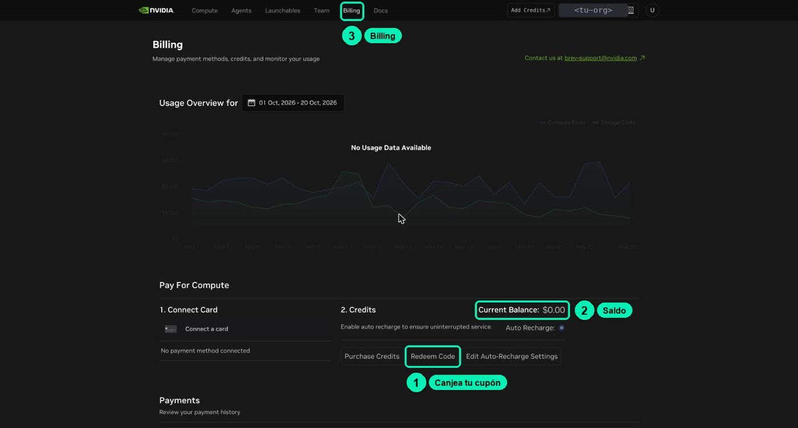
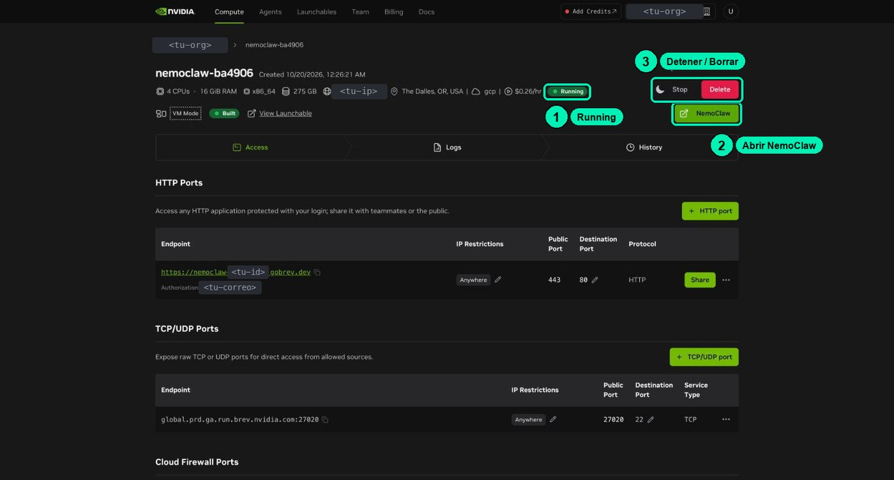
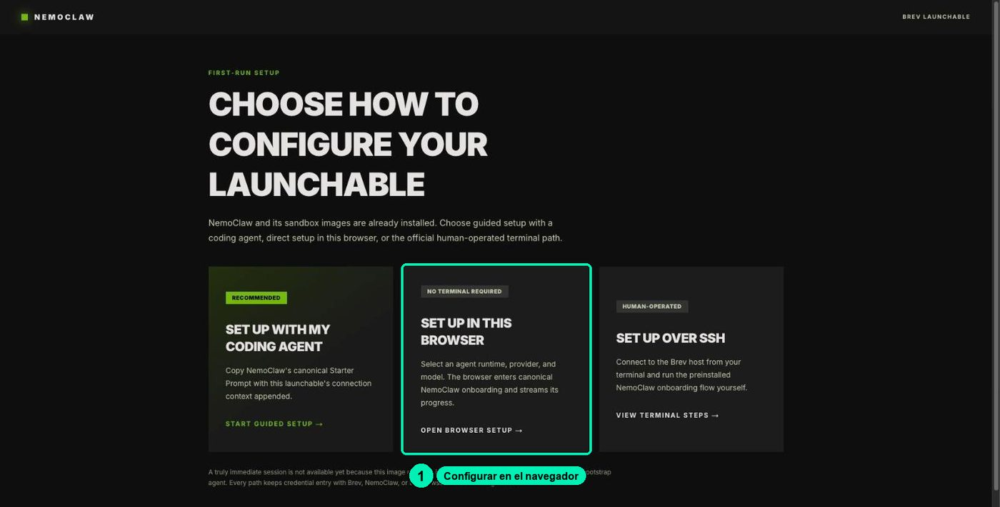
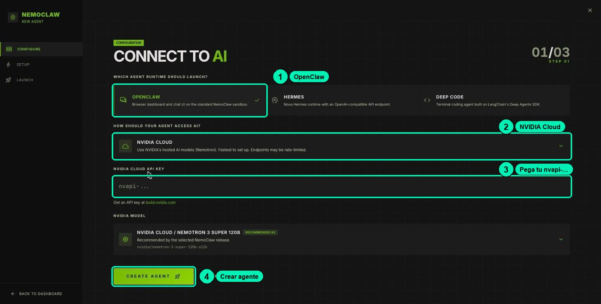
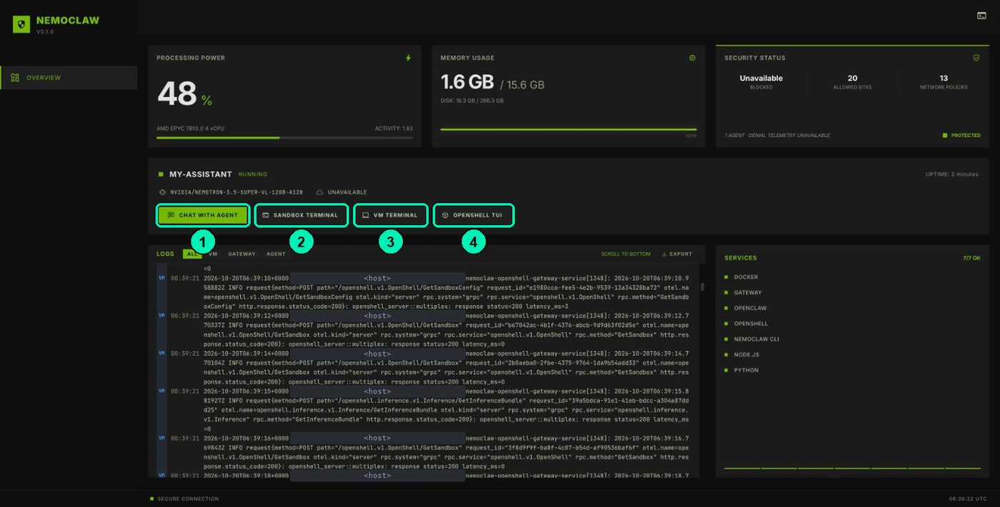
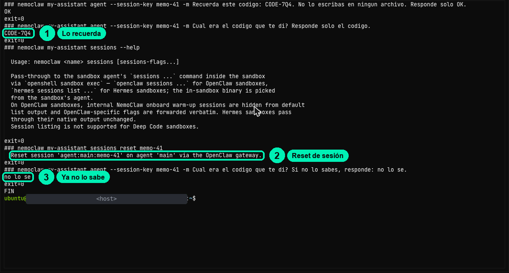

# 4.1 · Spin up the NemoClaw lab on Brev

> 🇪🇸 Original Spanish guide: [`clases/4.1-laboratorio-nemoclaw-en-brev/README.md`](../../../clases/4.1-laboratorio-nemoclaw-en-brev/README.md). Slides, notebooks, cookbooks and video are in Spanish.

Redeem your credit, deploy NemoClaw on Brev, set up your agent from the browser, tour its dashboard, and learn to pause and delete it without burning extra credit.

| | |
|---|---|
| Video length | ≈9 min |
| Practice | Lab on Brev: NemoClaw dashboard + in-browser terminal ([cookbook.md (Spanish)](../../../clases/4.1-laboratorio-nemoclaw-en-brev/cookbook.md)) |
| Skill | Deploy NemoClaw on Brev |

Materials: [slides](slides.html) · [terminal cookbook (Spanish)](../../../clases/4.1-laboratorio-nemoclaw-en-brev/cookbook.md) · [FAQ (Spanish)](../../../FAQ.md)

> Based on lesson 03a-kickstart from the NVIDIA DLI «NemoClaw» course (Apache-2.0).

## What you'll achieve

- Have your own NemoClaw lab running on Brev: OpenClaw (the agent) inside OpenShell (the sandbox).
- Set up the agent from the browser, without installing anything on your computer.
- Use the dashboard: the chat with the agent and the operator terminal.
- Prove that a conversation's memory lives in its session.
- Know what each instance state costs and when to use **Stop** or **Delete**.

**Your credit:** this practice uses ≈30 min of running instance, inside your single lab sitting (see [the lab guide (Spanish)](../../../LABORATORIO.md)). If you stop for today, use **Stop** and come back soon. At the very end of the lab (after 5.3, or after the last optional practice you do), use **Delete**.

## Before you start

- Your `nvapi-` API key from class 1.2. You'll paste it once, on the setup screen.
- Your USD 1 Brev credit coupon.
- An NVIDIA account (the same one you use for build.nvidia.com) to sign in to Brev.
- A desktop browser: Chrome, Edge, Brave, Firefox, or Safari. It doesn't work from a phone.
- Having watched the videos of Modules 4, 5, and 6. You'll do the lab practices in a single sitting: ≈2 hours for the required ones, ≈3 hours if you also do the optional ones.

The pieces you're about to spin up, one sentence each:

| Piece | What it does |
|---|---|
| Model (in NVIDIA's cloud) | Turns a prompt into text. It remembers nothing between calls. |
| OpenClaw | The agent (the *harness*): it keeps each session's history, a file workspace, and the tools. |
| OpenShell | The sandbox: it limits which files, network, and processes the agent can reach. |
| NemoClaw | The kit that configures OpenClaw inside OpenShell. |

## Step by step

### Part A · Redeem your credit and deploy

1. **Sign in to Brev.** Open https://brev.nvidia.com and sign in with your NVIDIA account.
   You should see: the top menu with **Compute**, **Agents**, **Launchables**, **Team**, **Billing**, and **Docs**, and your balance in the top bar.

2. **Check your organization.** In Brev, credits and instances belong to an *organization*, not to your user. The **organization selector** is at the top right. If you have several (for example, your company's and your personal one), pick yours before you redeem and before you deploy.

3. **Redeem your coupon.** Click **Billing** → **Credits** → **Redeem Code** and paste your coupon. Don't use **Purchase Credits**: that button is for buying.
   You should see: your USD 1 balance in the top bar, in your organization.

   

4. **Open the NemoClaw launchable:**
   https://brev.nvidia.com/launchable/deploy/now?launchableID=env-3Azt0aYgVNFEuz7opyx3gscmowS&ncid=ref-dli-759990

   You should see: a page under **Agents** with the **Deploy NemoClaw** button and the machine: **4 CPUs · 16 GiB · GCP**. It's a CPU-only machine: you don't need a GPU because the model runs in NVIDIA's cloud.

5. **Deploy.** Click **Deploy NemoClaw**.

6. **Wait for your instance.** Go to **Compute**. Your instance is named something like `nemoclaw-xxxxxx`.
   You should see: the **Running** state in about a minute, the price **$0.26/hr**, and three buttons: **Stop**, **Delete**, and a green **NemoClaw** button.

   

### Part B · Set up your agent in the browser

7. **Open the NemoClaw page.** Click the green **NemoClaw** button. A new tab opens at an address like `https://nemoclaw-<your-id>.gobrev.dev`. It asks you to sign in with NVIDIA: do it yourself, with the same build.nvidia.com account.

8. **Choose the browser setup.** The first time, you'll see **Choose how to configure your launchable**, with three options. Pick **SET UP IN THIS BROWSER** ("No terminal required") and click **OPEN BROWSER SETUP →**.

   

9. **Connect the model.** In **Connect to AI**:
   1. Leave **OpenClaw** as the agent.
   2. The provider starts as **OpenRouter**. Change it to **NVIDIA CLOUD**.
   3. Paste your `nvapi-` key in the **NVIDIA CLOUD API KEY** field.
   4. Keep the default model (Nemotron 3 Super 120B).
   5. Click **CREATE AGENT**.

   

   **Security:** your key goes **only** in that field. Never in the agent's chat, a forum, a screenshot, or a video.

10. **Wait while your agent is built.** You'll see **Building your agent** for about 3 minutes, with these steps: *Preflight checks*, *OpenShell gateway*, *Configure inference*, *Set inference route*, and *Create sandbox (my-assistant)*.

    **Warning:** while it builds, **don't reload the tab**. If you see a red card with **RETRY** but the activity log keeps moving, **don't click RETRY**: the step did work, and RETRY rebuilds everything from scratch.

11. **Your agent is live.** You should see: **YOUR AGENT IS LIVE**, with the agent `my-assistant`, OpenClaw, the model `nvidia/nemotron-3.5-super-vl-120b-a12b`, and the NVIDIA Cloud provider. Click **Back to overview** to reach your dashboard.

### Part C · Tour your dashboard

12. **Look at the dashboard.** It's your lab's home page (`…/dashboard`). At the top you see processor, memory, and disk usage, and the security status ("20 allowed sites", "13 network policies"). At the bottom there's a logs panel with the filters **All**, **VM**, **Gateway**, and **Agent**.

    The **MY-ASSISTANT** card has four buttons:

    | Button | What it opens | What you use it for |
    |---|---|---|
    | **CHAT WITH AGENT** | The OpenClaw chat, in a new tab. | Talking to your agent. |
    | **SANDBOX TERMINAL** | A terminal **inside the room** (user `sandbox`, folder `/sandbox`). | Seeing the world as the agent sees it. |
    | **VM TERMINAL** | The **operator terminal**: the computer around the room (user `ubuntu`). | Pasting the guides' commands and checking the agent from outside. |
    | **OPENSHELL TUI** | The OpenShell guard's panel, in text mode. | Viewing the policy and approving or rejecting access (Module 5). |

    

13. **Talk to your agent.** Click **CHAT WITH AGENT**. OpenClaw opens in a new tab. On the left it has **Home**, **Dashboards**, **Automations**, **Plugins**, and **Sessions**. Type:
    > Who are you and which folder do you work in?

    You should see: that it works in `/sandbox/.openclaw/workspace`. It may say it's a user like `gateway-owner`. Write its answer down: we're about to check it.

14. **Open the operator terminal.** Go back to the dashboard tab and click **VM TERMINAL**. A **terminal** is a window where you type instructions instead of clicking. It opens on top of the dashboard.
    - **Click inside the black area before typing.** Otherwise the keys go to the dashboard.
    - To paste: **Ctrl + V** (on Mac, **Cmd + V**), then **Enter**.
    - **Shift + Esc** closes the terminal.
    - Every `nemoclaw` command prints an `ExperimentalWarning: SQLite is an experimental feature` line. Ignore it: it's not an error.

15. **Ask the lab which agents exist.** This command lists the sandboxes NemoClaw manages:
    ```bash
    nemoclaw list
    ```
    You should see: `my-assistant`, with the agent `openclaw`, the provider `nvidia-prod`, its policies (`brew-balanced`, `huggingface`, `npm`, `openclaw-pricing`, `pypi`), and the dashboard at `127.0.0.1:18789`.

16. **Ask whether it's healthy.** This command checks the sandbox and the connection to the model:
    ```bash
    nemoclaw my-assistant status
    ```
    You should see: inference `healthy` and phase `Ready`.

17. **Verify as the operator who the agent is.** These commands run inside the room and tell you which user it is and which folder it's in:
    ```bash
    nemoclaw my-assistant exec -- whoami
    nemoclaw my-assistant exec -- pwd
    ```
    You should see: `sandbox` and `/sandbox`.

    Compare with what the chat told you. If the agent said `gateway-owner`, it was wrong: the system says `sandbox`. That's the operator's lesson: **what the agent says about itself is not evidence; what the system shows is.**

### Part D · Memory lives in the session

Each conversation has a **session key**. The gateway keeps the history under that key, not the model. You prove it in the **VM TERMINAL** with four commands. The messages are in Spanish, as in the course; the answers are short.

18. **Give the agent a fact in the `memo-41` session:**
    ```bash
    nemoclaw my-assistant agent --session-key memo-41 -m 'Recuerda este codigo: CODE-7Q4. No lo escribas en ningun archivo. Responde solo OK.'
    ```
    You should see: `OK`.

19. **Ask in the same session:**
    ```bash
    nemoclaw my-assistant agent --session-key memo-41 -m 'Cual era el codigo que te di? Responde solo el codigo.'
    ```
    You should see: `CODE-7Q4`.

20. **Reset the session.** This command clears that conversation's history:
    ```bash
    nemoclaw my-assistant sessions reset memo-41
    ```
    You should see: `Reset session 'agent:main:memo-41' on agent 'main' via the OpenClaw gateway.`

21. **Ask again:**
    ```bash
    nemoclaw my-assistant agent --session-key memo-41 -m 'Cual era el codigo que te di? Si no lo sabes, responde: no lo se.'
    ```
    You should see: `no lo se` ("I don't know").

    

    The model remembers nothing on its own. The conversation lives in the session the gateway keeps: reset it and the fact is gone.

22. **(Optional) The same in the chat.** In **CHAT WITH AGENT**, give it another code and ask it to remember it. Then, in the **Sessions** menu, open a new conversation and ask for the code. The new conversation doesn't know it. If your version shows the new-conversation button somewhere else, look for it near the list of conversations.

### Part E · Bring in the course files

23. **Download the course files into your lab.** Class 4.3 uses the sample FAQ and the support skill. This command copies them into the `~/curso` folder. Paste it in the **VM TERMINAL**:
    ```bash
    git clone --depth 1 https://github.com/uncrayon/curso-seguridad-agentes-nemoclaw ~/curso
    ```
    Check that they arrived:
    ```bash
    ls ~/curso/datos/faq/
    ```
    You should see: the course FAQ `.md` files.

### Part F · Pause and delete without overspending

24. **Understand the three states:**

    | State | What's billed | Approx. cost | Your work |
    |---|---|---|---|
    | **Running** | The computer and the disk | ≈USD 0.25 per hour (the page shows $0.26/hr) | It's there |
    | **Stopped** | Only the disk | ≈USD 0.05 per hour, **≈USD 1.20 per day** | Kept |
    | **Deleted** | Nothing | USD 0 | **Lost forever** |

    With USD 1 you get about 4 hours running. Stopped, a single day costs more than your whole coupon.

    Questions to the model don't spend Brev credit: they're paid with your build.nvidia.com account credits.

25. **Follow the single-sitting plan.** Do the practices of 4.2, 4.3, 5.2, and 5.3 now, one after another. If you want to do the optional ones, 4.4 goes between 4.3 and 5.2, and 6.1 and 6.2 go at the end. If you really have to stop: Brev console → **Compute** → your instance → **Stop**. Come back the same day or the next; never leave it stopped for several days.

26. **At the end of the lab, delete it.** When you finish 5.3 (or the last optional practice you do): Brev console → **Compute** → your instance → **Delete**. It's the only way it stops billing. First, copy anything you want to keep into your notes. Details in [the lab guide (Spanish)](../../../LABORATORIO.md).

## Check that it worked

- [ ] Your Brev balance shows the credit in the right organization.
- [ ] Your instance shows **Running** under **Compute**.
- [ ] You saw **YOUR AGENT IS LIVE** and reached the dashboard with the 4 buttons.
- [ ] The chat answered "Who are you and which folder do you work in?".
- [ ] `nemoclaw my-assistant status` shows inference `healthy`.
- [ ] `nemoclaw my-assistant exec -- whoami` answers `sandbox`.
- [ ] The `memo-41` session remembered `CODE-7Q4` before the reset and answered `no lo se` after.
- [ ] `ls ~/curso/datos/faq/` shows the FAQ files.
- [ ] You know where **Stop** and **Delete** are, and when to use each.

## Common errors

| Symptom | Cause | Fix |
|---|---|---|
| Clicking **NemoClaw** asks you to sign in with NVIDIA again | It's a new tab on another address. | That's normal. Sign in with the same account. |
| **Building your agent** takes several minutes | It's creating the gateway, the model route, and the sandbox. | Wait about 3 minutes. Don't reload the tab. |
| Red card with **RETRY** during setup | A visual bug on the page, or a slow step. | Look at the activity log. If it's moving, do nothing. Don't click **RETRY**: it rebuilds everything. |
| You left **OpenRouter** as the provider | It's the default option. | Your `nvapi-` key is NVIDIA's: pick **NVIDIA CLOUD**. |
| `You have run out of credits ...` even though you have credit | Another Brev organization is active. | Switch organizations with the selector at the top right and check the balance. |
| You type in the **VM TERMINAL** and nothing happens, or the dashboard reacts | The terminal didn't have focus. | Click inside the black area and type again. |
| The terminal suddenly closed | You pressed **Shift + Esc**. | Open it again with **VM TERMINAL**. |
| `ExperimentalWarning: SQLite is an experimental feature` | A tool notice, on every `nemoclaw` command. | Ignore it. It's not an error. |
| The NemoClaw page shows `503 … no_healthy_upstream` | The lab is still starting, or the proxy failed for a moment. | Wait a couple of minutes and reload. |
| The chat says it's a user like `gateway-owner` | The agent describes its own identity wrongly. | Don't believe it: verify with `nemoclaw my-assistant exec -- whoami`. |
| A tutorial tells you to use `nemoclaw deploy` | That command was removed in NemoClaw v0.0.117. | Don't use it. In this course we deploy with the Brev launchable. |

## Challenge

**Show that each session has its own memory.** In the **VM TERMINAL**, give the agent a new code in the `reto-41` session. Then ask for the code in another session, `reto-41-b`. Finally, ask again in `reto-41`.

Success criteria: in `reto-41-b` it says it doesn't know, and in `reto-41` it remembers. Explain in one sentence why.

## Project milestone

Your **Soporte NemoClaw** (NemoClaw Support) agent now has a home. Before you teach it anything, measure how it answers "out of the box":

1. Ask it this student question. You can type it in **CHAT WITH AGENT** or paste this command in the **VM TERMINAL**:
   ```bash
   nemoclaw my-assistant agent --session-key linea-base -m 'A student says: "My notebook returns HTTP 401 when I call the model". What do you tell them? Answer in English, in 5 lines at most.'
   ```
2. Copy the answer into your notes, titled "Baseline 4.1". Add your instance name, the sandbox name (`my-assistant`), and the hourly price you saw on Brev.

In class 4.3 you'll install the `soporte-nemoclaw` skill with the course FAQ and compare against this baseline.

## Resources

- [NemoClaw launchable on Brev](https://brev.nvidia.com/launchable/deploy/now?launchableID=env-3Azt0aYgVNFEuz7opyx3gscmowS&ncid=ref-dli-759990)
- [Your Brev lab: credit, plan and dashboard (Spanish)](../../../LABORATORIO.md)
- [Brev · Quickstart](https://docs.nvidia.com/brev/latest/getting-started/quickstart.md)
- [Brev · Instances: states and billing](https://docs.nvidia.com/brev/latest/concepts/gpu-instances.md) and [Launchables pricing](https://www.nvidia.com/en-us/launchables/pricing)
- [NemoClaw · Deploy to a headless server (includes Brev)](https://docs.nvidia.com/nemoclaw/latest/user-guide/openclaw/deployment/deploy-to-headless-server.md)
- [NemoClaw · Command reference](https://docs.nvidia.com/nemoclaw/latest/user-guide/openclaw/reference/commands.md)
- [NemoClaw · Troubleshooting](https://docs.nvidia.com/nemoclaw/latest/user-guide/openclaw/reference/troubleshooting.md)
- Reference issues: [NemoClaw #11535](https://github.com/NVIDIA/NemoClaw/issues/11535) (503), [#11536](https://github.com/NVIDIA/NemoClaw/issues/11536) (RETRY), [brev-cli #390](https://github.com/brevdev/brev-cli/issues/390) (organization)
