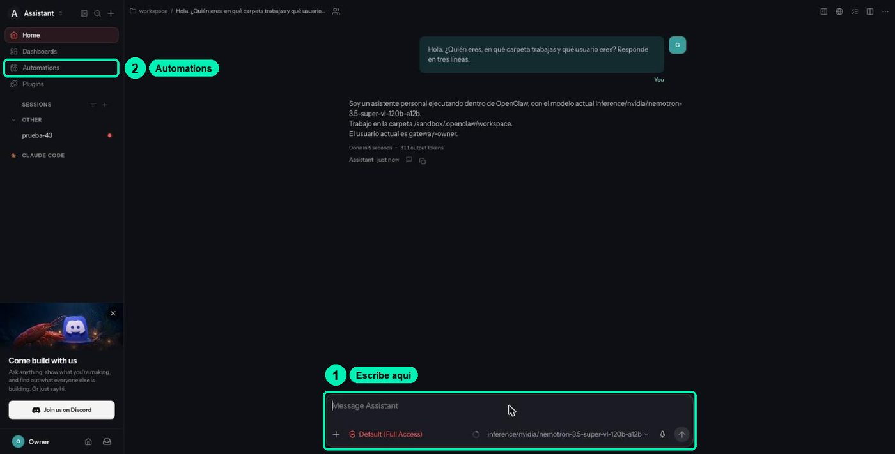

# 4.2 · Explore the OpenClaw gateway and workspace

> 🇪🇸 Original Spanish guide: [`clases/4.2-gateway-y-workspace-openclaw/README.md`](../../../clases/4.2-gateway-y-workspace-openclaw/README.md). Slides, notebooks, cookbooks and video are in Spanish.

Open the folder that defines your agent, compare what the agent says about itself with what's on disk, and customize it for the Soporte NemoClaw (NemoClaw Support) project.

| | |
|---|---|
| Video length | ≈8 min |
| Practice | Lab on Brev: NemoClaw dashboard + in-browser terminal ([cookbook.md (Spanish)](../../../clases/4.2-gateway-y-workspace-openclaw/cookbook.md)) |
| Skill | Orientation (no assessed skill) |

Materials: [slides](slides.html) · [terminal cookbook (Spanish)](../../../clases/4.2-gateway-y-workspace-openclaw/cookbook.md) · [FAQ (Spanish)](../../../FAQ.md)

> Based on lesson 03b-openclaw from the NVIDIA DLI «NemoClaw» course (Apache-2.0).

## What you'll achieve

- Name the pieces of OpenClaw (gateway, sessions, workspace) and which workspace file shapes each part of the behavior.
- Verify as the operator, with `ls` and `cat`, what the agent claims about its files and its memory.
- Customize `SOUL.md` so your agent behaves like **Soporte NemoClaw**, and test it in a new session.
- List and reset sessions, and check that what's written to files survives into a new session.

**Your credit:** this practice uses ≈20 min of running instance, inside your single lab sitting (see [the lab guide (Spanish)](../../../LABORATORIO.md)). If you stop for today, use **Stop** and come back soon. At the very end of the lab (after class 6.1), use **Delete**.

## Before you start

- Class 4.1 finished: instance **Running**, your `my-assistant` agent live, and the dashboard open.
- If you closed the tab: Brev console → **Compute** → your instance → green **NemoClaw** button. It may ask you to sign in with NVIDIA again; that's normal.
- Remember how to use the **VM TERMINAL**: click inside the black area before typing, and ignore the `ExperimentalWarning: SQLite is an experimental feature` line.

## The pieces, in one table

| Piece | Where it lives | What it does |
|---|---|---|
| OpenClaw gateway | Inside the sandbox, port 18789 | Receives every turn, runs the agent loop, and serves the chat you open with **CHAT WITH AGENT**. |
| OpenShell gateway | On the machine (the host), port 18080, local only | Manages the sandbox lifecycle and the route to the model. You see it with `openshell gateway info`. |
| Sessions | In the OpenClaw gateway | The history of each conversation, identified by its session key. |
| Workspace | `/sandbox/.openclaw/workspace/` | Markdown files the agent reads **at the start of every session**. They are its configuration. |

The workspace, file by file:

| File | What it defines |
|---|---|
| `SOUL.md` | Personality, boundaries, tone, and values. |
| `AGENTS.md` | Operating instructions and rules: memory, safety, the flow of each session. |
| `IDENTITY.md` | A short card: name, language, emoji. |
| `USER.md` | Who the person it helps is, and their preferences. |
| `TOOLS.md` | Usage notes for each tool. |
| `HEARTBEAT.md` | A list of periodic tasks (we cover it in 4.3). |
| `POLICY.md` | A summary of the network policy, written by NemoClaw. |
| `memory/` | Daily `AAAA-MM-DD.md` (YYYY-MM-DD) notes the agent appends as it works. Created the first time the agent saves a note. |
| `MEMORY.md` | Curated long-term memory. Created the first time the agent uses it. |
| `skills/` | One folder per skill, with its `SKILL.md`. It shows up when you install the first skill (class 4.3). |

One detail causes a lot of errors: inside the sandbox, `~` is `/sandbox`, **not** the workspace. `~/SOUL.md` points to `/sandbox/SOUL.md`, which the agent doesn't read as its personality. Always use the full path `/sandbox/.openclaw/workspace/SOUL.md`.

## Step by step

### Part A · Ask the agent to describe itself (chat)

1. **Open the chat.** On the dashboard, **MY-ASSISTANT** card, click **CHAT WITH AGENT**. OpenClaw opens in a new tab.

   

2. **Ask it to describe its desk.** Type:
   > Briefly list the files in your workspace and explain each one in a bullet, without dumping their contents.

   You should see: a list of files with one explanation per bullet. **Write it down**: it's what the agent *says*.

### Part B · Verify as the operator

3. **Open the operator terminal.** Go back to the dashboard tab and click **VM TERMINAL**.

4. **List the real workspace.** This command asks the sandbox for the list of files on the agent's desk:
   ```bash
   nemoclaw my-assistant exec -- ls -la /sandbox/.openclaw/workspace
   ```
   You should see, in a freshly created lab: `AGENTS.md`, `HEARTBEAT.md`, `IDENTITY.md`, `POLICY.md`, `SOUL.md`, `TOOLS.md`, and `USER.md`. There's **no** `MEMORY.md`, `memory/`, or `skills/` yet, and that's normal.

5. **Read its personality and its rules.** These commands show the contents of `SOUL.md` and the start of `AGENTS.md`:
   ```bash
   nemoclaw my-assistant exec -- cat /sandbox/.openclaw/workspace/SOUL.md
   nemoclaw my-assistant exec -- head -n 30 /sandbox/.openclaw/workspace/AGENTS.md
   ```

6. **Compare.** Did the agent mention a file that doesn't exist, like `MEMORY.md`? Did it forget one, like `POLICY.md`? That gap is the point of the class: **what the agent says is not evidence; the file is**.

   Why it works this way: the lab has two planes of authority. The **VM TERMINAL** is the operator and runs **outside** the sandbox. The agent runs **inside**, under a narrower policy.

7. **(Optional) Look at the desk from inside.** On the dashboard, click **SANDBOX TERMINAL**. That terminal is inside the room, like the agent. Type:
   ```bash
   whoami; echo "$HOME"
   ls /sandbox/.openclaw/workspace
   ```
   You should see: `sandbox`, `/sandbox`, and the same list of files. Notice: here `~` is `/sandbox`, not the workspace.

### Part C · Customize SOUL.md for Soporte NemoClaw

You'll write your section into a file on the machine, upload it to the sandbox, and append it to the end of `SOUL.md`. All in the **VM TERMINAL**. The section stays in Spanish, as the course project answers in Spanish.

8. **Write your section into a file.** This command creates `~/soul-extra.md` on the machine with the text between the two `EOF` lines. Replace the text with your own, or use this one:
   ```bash
   cat > ~/soul-extra.md <<'EOF'

   ## Proyecto: Soporte NemoClaw
   - Ayudas a estudiantes del curso "Seguridad de agentes con OpenShell y NemoClaw".
   - Respondes en español neutro, con frases cortas y pasos numerados.
   - Antes de responder, clasificas la duda en una categoría: instalacion, api_key, brev, seguridad u otro.
   - Si usas la FAQ del curso, citas el archivo de donde sale la respuesta.
   - Nunca pides, repites ni guardas API keys, tokens o cookies. Si alguien pega una, le pides que la revoque.
   - Si no sabes algo, lo dices y sugieres preguntar en el foro del curso.
   EOF
   ```
   If you prefer an editor, use `nano ~/soul-extra.md`, paste the text, save with **Ctrl + O**, **Enter**, and exit with **Ctrl + X**.

9. **Keep a copy of the original.** This command copies `SOUL.md` to the sandbox's `/tmp` folder, in case you want to go back:
   ```bash
   nemoclaw my-assistant exec -- cp /sandbox/.openclaw/workspace/SOUL.md /tmp/SOUL.md.original
   ```

10. **Upload your section to the sandbox.** This command copies the file from the machine to the sandbox's `/tmp` folder, and the second one checks that it arrived:
    ```bash
    nemoclaw my-assistant upload ~/soul-extra.md /tmp/
    nemoclaw my-assistant exec -- ls -la /tmp/soul-extra.md
    ```
    You should see: the `soul-extra.md` file, owned by `sandbox`.

11. **Append it to SOUL.md and read it back.** The first command appends your section to the end of the file, inside the sandbox. The second shows the last lines:
    ```bash
    nemoclaw my-assistant exec -- sh -c 'cat /tmp/soul-extra.md >> /sandbox/.openclaw/workspace/SOUL.md'
    nemoclaw my-assistant exec -- tail -n 9 /sandbox/.openclaw/workspace/SOUL.md
    ```
    You should see: the "Proyecto: Soporte NemoClaw" section at the end.

    Use `>>` (two signs), not `>`: with just one, you wipe everything that was in `SOUL.md`.

    To go back to the original: `nemoclaw my-assistant exec -- cp /tmp/SOUL.md.original /sandbox/.openclaw/workspace/SOUL.md`. The copy in `/tmp` is erased if you stop the instance.

### Part D · Test it in a new session

The agent reads the workspace at the **start** of each session. A conversation that was already open doesn't change.

12. **Ask in a new session.** In the **VM TERMINAL**:
    ```bash
    nemoclaw my-assistant agent --session-key soul-42 -m 'Who are you, who do you help, and what do you never do?'
    ```
    Or in **CHAT WITH AGENT**: in the **Sessions** menu, open a new conversation and ask the same question.

    You should see: it mentions the course, neutral Spanish, and that it never asks for API keys.

### Part E · Sessions and memory in files

13. **List your sessions.** This command shows the conversations the gateway keeps, in an easy-to-read format:
    ```bash
    nemoclaw my-assistant sessions list --json
    ```
    You should see: a JSON with your sessions and fields like `"agentId": "main"` and `"kind": "direct"`. Look for the keys you used (`memo-41`, `soul-42`). Without `--json`, the table is too wide for the browser terminal.

14. **Ask the agent to save a preference to a file.** This is memory on disk, not in the conversation:
    ```bash
    nemoclaw my-assistant agent --session-key memoria-a -m 'Agrega esta linea al final de /sandbox/.openclaw/workspace/MEMORY.md sin borrar nada: "soporte-pref-01: responde en español neutro y cita el archivo de la FAQ que usaste. Referencia REF-4821." Despues leelo de vuelta y cita la linea.'
    ```
    You should see: the agent says it saved it. Don't believe it yet.

15. **Check it as the operator.** This command searches for the reference inside the file:
    ```bash
    nemoclaw my-assistant exec -- grep -n "REF-4821" /sandbox/.openclaw/workspace/MEMORY.md
    ```
    You should see: the line with `REF-4821`. If it doesn't show up, the agent didn't write it there, even if it said so.

16. **Reset the session and ask from another one.** Resetting clears the conversation, not the files:
    ```bash
    nemoclaw my-assistant sessions reset memoria-a
    nemoclaw my-assistant agent --session-key memoria-b -m 'Lee /sandbox/.openclaw/workspace/MEMORY.md e indica la preferencia y la referencia de soporte-pref-01.'
    ```
    You should see: `REF-4821` in the new session's answer. The conversation is gone; the file stayed.

## Check that it worked

- [ ] You wrote down the list of files the agent gave you and the real `ls` list, and you know whether they match.
- [ ] You read `SOUL.md` and `AGENTS.md` as the operator.
- [ ] `tail` shows the "Proyecto: Soporte NemoClaw" section at the end of `SOUL.md`.
- [ ] A new session (`soul-42`) answers with the Soporte NemoClaw identity.
- [ ] `sessions list --json` shows your session keys.
- [ ] `REF-4821` is in `MEMORY.md`, and the `memoria-b` session recovers it.

## Common errors

| Symptom | Cause | Fix |
|---|---|---|
| The agent says "done, I saved it" but the file didn't change | The model reports an action it didn't take, or it wrote to another path. | Always verify with `cat` or `grep` as the operator. Ask again with the full path and have it read the file back. |
| You wrote to `~/SOUL.md` and the agent didn't change | Inside the sandbox, `~` is `/sandbox`, not the workspace. You wrote `/sandbox/SOUL.md`. | Use `/sandbox/.openclaw/workspace/SOUL.md`. Delete the stray file: `nemoclaw my-assistant exec -- rm /sandbox/SOUL.md`. |
| You changed `SOUL.md` and the open conversation stays the same | The workspace is read at the start of each session. | Test with a new session key or a new conversation under **Sessions**. |
| `SOUL.md` ended up with only your section | You used `>` instead of `>>`. | Restore the copy: `nemoclaw my-assistant exec -- cp /tmp/SOUL.md.original /sandbox/.openclaw/workspace/SOUL.md` and repeat with `>>`. |
| After pasting the `cat > … <<'EOF'` block, the terminal shows `>` and waits | The final `EOF` line is missing, or has spaces before it. | Type `EOF` on its own, at the start of the line, and press **Enter**. |
| `MEMORY.md`, `memory/`, or `skills/` doesn't exist | The agent hasn't saved memory or had skills installed yet. | That's normal. They're created the first time they're needed. |
| `ls: cannot access '/tmp/soul-extra.md'` | The file didn't reach the sandbox, or landed on another path. | Repeat the `upload` and check with `nemoclaw my-assistant exec -- ls -la /tmp/`. |
| `Pairing required` in the chat | The lab's chat comes already paired; this notice shouldn't show up. | Close the tab and open the chat again from **CHAT WITH AGENT** on the dashboard. |
| You ran `openclaw update` inside the sandbox and it hung | OpenClaw is pinned in the sandbox image. It isn't updated in place. | Don't do it. Cancel with `Ctrl+C`. In the course lab, don't touch versions. |

## Challenge

**Make the agent prove what it saves.** Add this rule to the end of `AGENTS.md`, with the same method as Part C (file on the machine, `upload` to `/tmp`, and `cat >>`):

```text
- Cada vez que digas que guardaste algo en un archivo, léelo de vuelta y cita la línea exacta que quedó escrita.
```

("Every time you say you saved something to a file, read it back and quote the exact line that was written.")

Success criteria: in a new session, you ask it to save a preference to `MEMORY.md`, its answer includes the line it read back, and `grep` as the operator confirms that line exists.

## Project milestone

Your agent now has the **Soporte NemoClaw** identity:

- `SOUL.md` with the project section (language, triage categories, the no-keys rule).
- `MEMORY.md` with the `soporte-pref-01` preference (cite the FAQ file).

Copy the section you added to `SOUL.md` into your notes. Then repeat the 4.1 baseline question in a new session:

```bash
nemoclaw my-assistant agent --session-key linea-base-42 -m 'A student says: "My notebook returns HTTP 401 when I call the model". What do you tell them? Answer in 5 lines at most.'
```

Write down in your notes, under the baseline, what changed. It doesn't know the FAQ yet: that comes in 4.3 with the `soporte-nemoclaw` skill.

## Resources

- [NemoClaw · Sandbox state and workspace files](https://docs.nvidia.com/nemoclaw/latest/user-guide/openclaw/manage-sandboxes/workspace-files.md)
- [NemoClaw · Command reference](https://docs.nvidia.com/nemoclaw/latest/user-guide/openclaw/reference/commands.md) (`exec`, `agent`, `sessions`, `upload`)
- [NemoClaw · Troubleshooting](https://docs.nvidia.com/nemoclaw/latest/user-guide/openclaw/reference/troubleshooting.md)
- [OpenClaw · Documentation](https://docs.openclaw.ai)
- [Your Brev lab: credit, plan and dashboard (Spanish)](../../../LABORATORIO.md)
- [MemGPT: tiered memory for LLMs (arXiv 2310.08560)](https://arxiv.org/abs/2310.08560)
