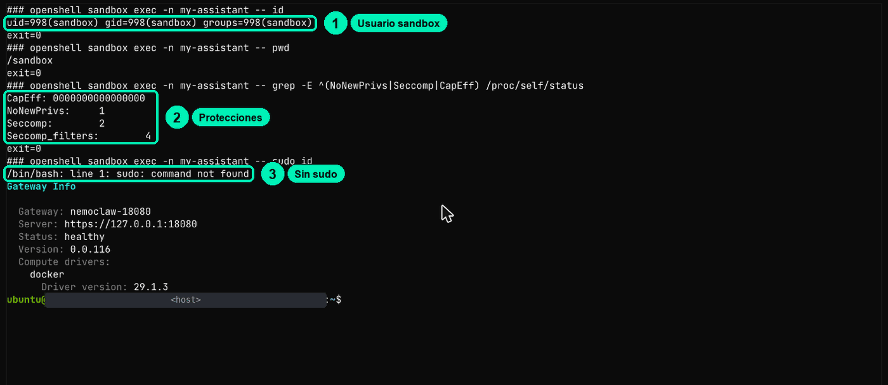
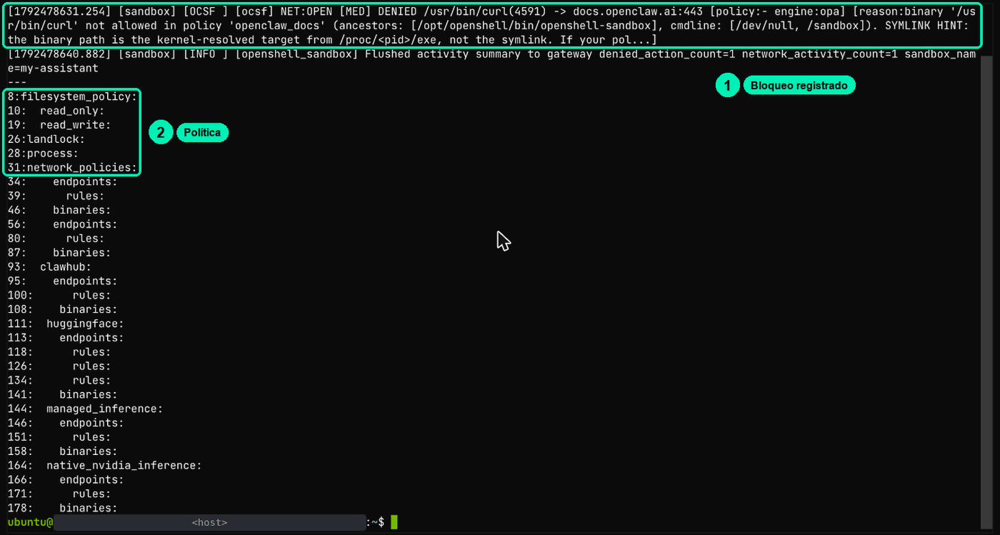
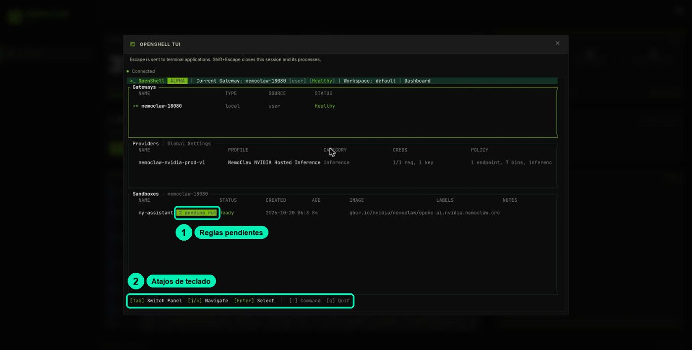
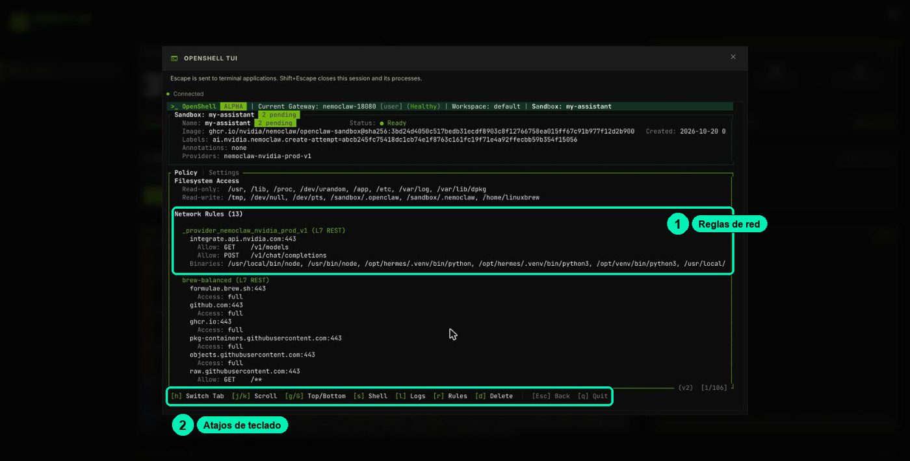

# 5.2 · Identities and boundaries with OpenShell

> 🇪🇸 Original Spanish guide: [`clases/5.2-identidades-openshell/README.md`](../../../clases/5.2-identidades-openshell/README.md). Slides, notebooks, cookbooks and video are in Spanish.

Prove with evidence who your agent is inside the sandbox, which programs can reach the network, and where your API key is (and isn't).

| | |
|---|---|
| Video length | ≈9 min |
| Practice | Lab on Brev: NemoClaw dashboard + in-browser terminal ([cookbook.md (Spanish)](../../../clases/5.2-identidades-openshell/cookbook.md)) |
| Skill | Configure agent identities in OpenShell |

Materials: [slides](slides.html) · [lab cookbook (Spanish)](../../../clases/5.2-identidades-openshell/cookbook.md) · [FAQ (Spanish)](../../../FAQ.md)

> Based on lesson 04a-safety from the NVIDIA DLI «NemoClaw» course (Apache-2.0).

## What you'll achieve

- Show that the agent runs as the `sandbox` user, without root, with seccomp active and no way to escalate, and compare that with the operator's power.
- Explain why OpenShell grants network permissions **per program** (the binary's real path) and not to "the agent" in general.
- Check in the log that an answer from the agent doesn't prove it had access.
- Show that the real API key never enters the sandbox: inside, there's only a placeholder.

**Your credit:** this practice uses ≈20 min of running instance, inside your single lab sitting (see [the lab guide (Spanish)](../../../LABORATORIO.md)). If you stop for today, use **Stop** and come back soon. At the very end of the lab (after 5.3, or after the last optional practice you do), use **Delete**.

## Before you start

- Your NemoClaw lab on Brev is running and you reached its dashboard (`https://nemoclaw-<your-id>.gobrev.dev/dashboard`) with the green **NemoClaw** button in the Brev console (class 4.1).
- You know how to open the **VM TERMINAL** from the dashboard, click the black area before typing, and paste commands (see [the lab guide (Spanish)](../../../LABORATORIO.md)).
- Your sandbox is called `my-assistant` (or you wrote down the name that `openshell sandbox list` shows).
- You made your `trifecta.md` worksheet in class 5.1.

## Step by step

### Part 1 · Three different identities

Before you type anything, be clear about who we're talking about:

| Identity | Who it is | What power it has |
|---|---|---|
| **The agent process** | The `sandbox` user inside the container | Whatever Landlock, seccomp and the network policy allow |
| **The program (binary)** | The real path of the executable that opens the connection (`/usr/local/bin/openclaw`, `/usr/local/bin/node`, `/usr/bin/curl`) | The destinations its policy group allows |
| **The operator** | You, in the **VM TERMINAL**, with `nemoclaw` and `openshell` | Change policies, approve egress, read the gateway token |

### Part 2 · Two terminals, two levels of power

The dashboard has two terminals. One is **inside the agent's room** and the other is **outside**, where the operator is.

1. On the dashboard, click **SANDBOX TERMINAL**. Click inside the black area and type:

   ```bash
   whoami
   pwd
   id
   ```

   You see the world as the agent sees it: user `sandbox`, folder `/sandbox` and `uid=998(sandbox) gid=998(sandbox)`. Close it with **Shift + Esc**.

2. Now click **VM TERMINAL** and type the same:

   ```bash
   whoami
   id
   ```

   Here you're `ubuntu`, with `uid=1000(ubuntu)` and, among your groups, `sudo` and `docker`. The operator has power over the machine; the agent doesn't.

3. From the VM TERMINAL you can also ask the sandbox without going in. This command runs `id` inside the room and brings back the answer:

   ```bash
   openshell sandbox exec -n my-assistant -- id
   ```

   You should see `uid=998(sandbox) gid=998(sandbox)`.



Then ask the agent the same thing. In the chat (**CHAT WITH AGENT**) or with this VM TERMINAL command, which sends a message without opening the chat:

```bash
nemoclaw my-assistant agent -m "Use your exec tool to run whoami and pwd, and tell me in one sentence which user you are and where you are."
```

Compare its answer with what you saw. In one course test run, the agent said it worked in `/sandbox/.openclaw/workspace` but claimed to be the user `gateway-owner`; the real user is `sandbox`. As the operator, you **verify** what the agent says about itself.

### Part 3 · Read its authority in `/proc/self/status`

This command reads the record the process started with inside the sandbox. It's a safe test: it only reads a file.

```bash
openshell sandbox exec -n my-assistant -- grep -E '^(Uid|Gid|NoNewPrivs|Seccomp|Seccomp_filters|CapEff|CapBnd)' /proc/self/status
```

Look for three lines: `NoNewPrivs: 1`, `Seccomp: 2` and `CapEff: 0000000000000000`. They mean: no new privileges, a seccomp filter in place, and no root capabilities.

### Part 4 · Try to escalate (and read the error carefully)

These two commands try to become administrator from inside the sandbox:

```bash
openshell sandbox exec -n my-assistant -- sudo id
openshell sandbox exec -n my-assistant -- python3 -c 'import os; os.setuid(0)'
```

You'll see a `command not found` for the first one and `PermissionError: [Errno 1] Operation not permitted` for the second. Tell the messages apart:

- `command not found`: the tool doesn't exist in the image. It doesn't prove any boundary.
- `Permission denied` (`EACCES`): file permissions or Landlock. You'll see it with `touch /usr/local/bin/test`.
- `Operation not permitted` (`EPERM`): the kernel refused the operation (missing capabilities or seccomp).

A failure on its own doesn't tell you which mechanism stopped it. That's why Part 3 reads the process status. Recipe 3 in the cookbook has more probes to classify with this same table.

### Part 5 · The network permission is tied to the program

Ask `curl`, a program that downloads pages, to open the OpenClaw docs from the sandbox:

```bash
openshell sandbox exec -n my-assistant -- curl -sS -m 8 -o /dev/null -w 'code=%{http_code}\n' https://docs.openclaw.ai
```

You'll see `curl: (56) CONNECT tunnel failed, response 403`. That 403 comes from the OpenShell guard, not from the site. The destination is in the policy (group `openclaw_docs`), but not for `curl`. OpenShell identifies the program by its real path (`/proc/<pid>/exe`), not by the name it claims. Recipe 5 in the cookbook has attempts to fool the guard for you to try.

### Part 6 · An answer is not proof: read the log

Ask the agent for the same page, in the chat or with this command:

```bash
nemoclaw my-assistant agent -m "Open https://docs.openclaw.ai and tell me in one line what the page is about."
```

It will most likely answer with a convincing sentence about OpenClaw. Now check what really happened. This command looks for the latest denials in the lab log:

```bash
nemoclaw my-assistant logs --tail 300 | grep DENIED | tail -4
```

In the course test run, lines like these came out (trimmed):

```text
[sandbox] [OCSF ] [ocsf] NET:OPEN [MED] DENIED /usr/bin/curl(11932) -> docs.openclaw.ai:443 [policy:- engine:opa] [reason:binary '/usr/bin/curl' not allowed in policy 'openclaw_docs' (ancestors: [/usr/bin/bash -> /usr/local/bin/node -> /usr/bin/bash], cmdline: …
… DENIED /usr/local/bin/node(11950) -> docs.openclaw.ai:443 … [reason:binary '/usr/local/bin/node' not allowed in policy 'openclaw_docs' …
```



Read it like this: **who** (`/usr/bin/curl`, and its parent processes in `ancestors`: the agent runs on `node`), **where to** (`docs.openclaw.ai:443`) and **why** (that program isn't in `openclaw_docs`). The agent tried `curl` and then `node`, and the guard denied both. It still answered, with what it already knew. The lesson: **an answer doesn't prove there was access**. The log does.

### Part 7 · See the rules in the guard's panel

The **OPENSHELL TUI** button on the dashboard opens the guard's panel in text mode. It's the visual way to see the rules.

1. On the dashboard, click **OPENSHELL TUI**.
2. On the home screen, move with **j** and **k** to `my-assistant` and press **Enter**. (**Tab** switches panel, **q** quits.)

   

3. The sandbox view shows the read-only and read-write folders, and the network rules. **h** switches tab and **l** shows the log.

   

4. Press **r** (Rules). Blocked requests waiting for a decision show up there, like the `openclaw_docs` one from `curl`. Today you only look: approving or rejecting is class 5.3.

Don't press **d** in the sandbox view: it's **Delete** and it deletes the sandbox. To leave the panel, press **q**.

### Part 8 · Look for your API key inside the sandbox

This command shows the names of variables with "key" or "token" and hides their values, except the placeholder:

```bash
openshell sandbox exec -n my-assistant -- sh -c 'env | grep -iE "key|token" | sed -E "s/=(openshell:resolve:env:).*/=\1…/; t; s/=.*/=<oculto>/"'
```

Among the lines, you'll see `NVIDIA_INFERENCE_API_KEY=openshell:resolve:env:…` and `OPENCLAW_GATEWAY_TOKEN=<oculto>` ("hidden"). The first one **is not your key**: it's a voucher. The real key lives in the OpenShell gateway, outside the sandbox. The guard swaps the voucher for the key only when the request leaves through the allowed route to NVIDIA. If the agent prints that variable or sends it somewhere else, what leaks is worthless text. The second one is a real secret (the OpenClaw gateway token): that's why the filter hides it.

To confirm no `nvapi-` key was written in the sandbox, count the files that contain one. You should see `0`:

```bash
openshell sandbox exec -n my-assistant -- sh -c 'grep -rIl "nvapi-" /sandbox 2>/dev/null | wc -l'
```

Never run `env` without a filter, not even in the SANDBOX TERMINAL: it prints the gateway token.

## Check that it worked

- [ ] In the SANDBOX TERMINAL you're `sandbox` in `/sandbox`; in the VM TERMINAL you're `ubuntu`, with the `sudo` and `docker` groups.
- [ ] `/proc/self/status` shows `NoNewPrivs: 1`, `Seccomp: 2` and `CapEff` all zeros.
- [ ] `sudo id` and `os.setuid(0)` fail, and you know what each message means.
- [ ] `curl` to `docs.openclaw.ai` returns `CONNECT tunnel failed, response 403`.
- [ ] You found the agent's `DENIED` lines in the log, even though it answered.
- [ ] You saw the `my-assistant` rules in the OPENSHELL TUI.
- [ ] There's no `nvapi-` inside the sandbox: only the `openshell:resolve:env:…` placeholder.

## Common errors

| Symptom | Cause | Fix |
|---|---|---|
| You type in the terminal and nothing happens, or something else opens | The terminal doesn't have focus and the keys go to the dashboard | Click inside the black area before typing |
| `ExperimentalWarning: SQLite is an experimental feature` | A notice every `nemoclaw` command prints | Ignore it: it's not an error |
| `curl: (56) CONNECT tunnel failed, response 403` | The policy denied the connection (host or program not allowed). That's expected in Part 5 | It's not a TLS problem. See the reason with `nemoclaw my-assistant logs --tail 300 \| grep DENIED \| tail -4` |
| The agent answered and you see no denial | You searched too few log lines | Use `--tail 300` and filter with `grep DENIED`. If there's none, note that the agent didn't try to go out |
| `whoami` says `ubuntu` | You're in the VM TERMINAL, not inside the sandbox | Use the SANDBOX TERMINAL or `openshell sandbox exec -n my-assistant -- …` |
| `whoami` says `root` | You used `docker exec` on the container (it runs as root) | Use `openshell sandbox exec -n …` or `nemoclaw my-assistant exec -- …` |
| A command with a pipe (`grep … \| wc`) runs on the host | `openshell sandbox exec` takes arguments, not a shell line | Wrap the whole command in `-- sh -c '…'` |
| No `…KEY` variable shows up in Part 8 | Sandbox created with the `inference.local` route: it doesn't even get the placeholder | That's normal. The key isn't inside either |
| Sandbox not found error | Misspelled name (for example, `mi-asistente`) | Copy the exact name from `openshell sandbox list` |

## Challenge

Find **one destination your policy allows for `curl`** and another it denies, using only read commands and the OPENSHELL TUI to see the rules. Hint: try `https://integrate.api.nvidia.com/v1/models` and `https://docs.openclaw.ai`. Success criterion: two `curl` commands from the sandbox, one with `code=200` and one with `CONNECT tunnel failed, response 403`, plus one sentence that explains the difference (you'll go deep on it in 5.3).

## Project milestone

Add an **"Identity"** section to your *Soporte NemoClaw* (NemoClaw Support) `trifecta.md` with what you verified:

```markdown
## Identity (class 5.2)
- Runs as: sandbox (uid 998), NoNewPrivs 1, Seccomp 2, CapEff 0
- The operator (ubuntu) has sudo and docker; the agent doesn't
- Programs the agent uses to reach the network: /usr/local/bin/node (and curl from its tools)
- In the lab, docs.openclaw.ai was denied to curl and node, and the agent answered anyway: check the log
- Where the API key lives: OpenShell gateway (outside). In the sandbox: openshell:resolve:env:…
- Remaining risk: the OpenClaw gateway token (OPENCLAW_GATEWAY_TOKEN) is inside the sandbox
```

In class 5.3 you'll read the full policy and write the project's preset.

## Resources

- NVIDIA DLI · lesson 04a "The OpenShell Sandbox" of the "NemoClaw" course (Apache-2.0).
- NemoClaw · [Security Best Practices](https://docs.nvidia.com/nemoclaw/latest/) → "Binary-Scoped Endpoint Rules" (identification through `/proc/<pid>/exe` and a SHA256 hash).
- NemoClaw · Credential Storage (`docs/security/credential-storage.mdx`): `openshell:resolve:env:<KEY>` placeholders.
- NemoClaw · Process Controls (`docs/security/process-controls.mdx`): `no-new-privileges`, capabilities, `ulimit -u 512`.
- Linux kernel · [seccomp filter](https://docs.kernel.org/userspace-api/seccomp_filter.html) · man7 · [capabilities(7)](https://man7.org/linux/man-pages/man7/capabilities.7.html).
- [Your Brev lab: credit, plan and dashboard (Spanish)](../../../LABORATORIO.md).
- [FAQ (Spanish)](../../../FAQ.md).
